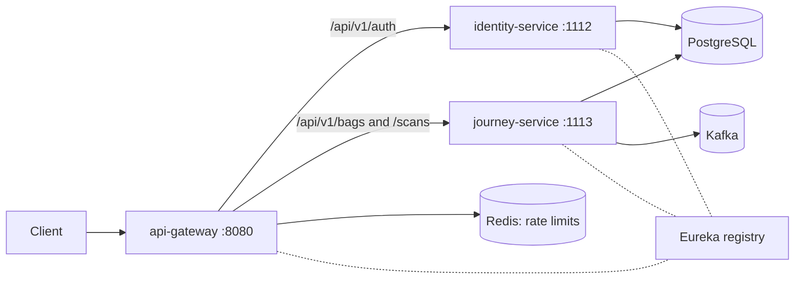
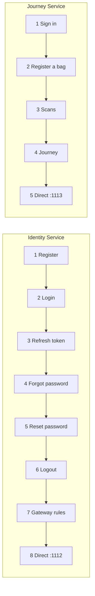

# API requests and flows

What the platform offers today, how a request flows through it, and how to try it in Postman.

## Documents

| Document | What it has |
|---|---|
| [Identity Service API](IDENTITY-API.md) | Calls, tokens and keys, flows, every Postman request |
| [Journey Service API](JOURNEY-API.md) | Calls, rules, scan formats, errors, events, flows, every Postman request |
| [README](../README.md) | Setup, variables, response format, rate limits, observability |

## At a glance

| What | Address | Routes |
|---|---|---|
| api-gateway (clients call this) | `http://localhost:8080` | `/api/v1/auth/**` to identity-service. `/api/v1/bags/**` and `/api/v1/scans/**` to journey-service |
| identity-service (direct) | `http://localhost:1112` | |
| journey-service (direct) | `http://localhost:1113` | |

Success answers look like `{"success":true,"data":...,"timestamp":...}`. Errors use the shared shape. See [API response format](../README.md#api-response-format).



## Postman collection

Two files in `postman/`:

| File | Content |
|---|---|
| `AeroTrace.postman_collection.json` | The requests, with test scripts |
| `AeroTrace-local.postman_environment.json` | The variables (`baseUrl`, `identityUrl`, `journeyUrl`, accounts, tokens) |

**Set up**

1. Start the stack with Docker Compose. The `dev` Liquibase context creates the dummy accounts.
2. Import both files into Postman.
3. Select the environment "AeroTrace - local". `baseUrl` is `http://localhost:8080`.
4. Run a service folder from top to bottom. Use a delay of 150 ms or more between requests. The gateway allows about 10 requests per second per address.

**Folders**

| Folder | Steps |
|---|---|
| Identity Service | 1 Register, 2 Login, 3 Refresh token, 4 Forgot password, 5 Reset password, 6 Logout, 7 Gateway rules, 8 Direct calls to port 1112 (`identityUrl`) |
| Journey Service | 1 Sign in, 2 Register a bag, 3 Scans, 4 Journey, 5 Direct calls to port 1113 (`journeyUrl`) |

**What each folder does**

| Folder | What it does |
|---|---|
| Identity Service | 1 Register creates a passenger. The later folders log in, refresh, reset the password and log out. The test scripts store the tokens in the environment. The refusals (wrong password, validation, duplicate, unknown tokens) are in the same folders |
| Identity Service 1.2 | Registers staff. Needs `adminUsername` and `adminPassword` in the environment. By default this is the dev dummy admin. You can also make the first admin by hand, see the [README](../README.md#first-administrator-without-the-dev-context) |
| Journey Service | Signs in the dev dummy agent and two dummy passengers, registers a bag, sends barcode, RFID and conveyor scans (an `Idempotency-Key` is generated for each), reads the journey as staff, as the owner and as another passenger, and checks the refusals. Needs the Compose stack with the `dev` Liquibase context |

Variables of the Journey Service folder: `journeyAgentUsername`, `journeyPassengerUsername`, `journeyOtherPassengerUsername`, `journeyAgentPassword`, `journeyPassengerPassword`.

**With newman**

```bash
newman run postman/AeroTrace.postman_collection.json -e postman/AeroTrace-local.postman_environment.json --delay-request 150 --folder "Identity Service"
```

Use `--folder "Journey Service"` for the journey folder.

**Run order of the collection**



The tables of every request are in [Identity Service API](IDENTITY-API.md#every-request-in-the-postman-collection) and [Journey Service API](JOURNEY-API.md#every-request-in-the-postman-collection).
