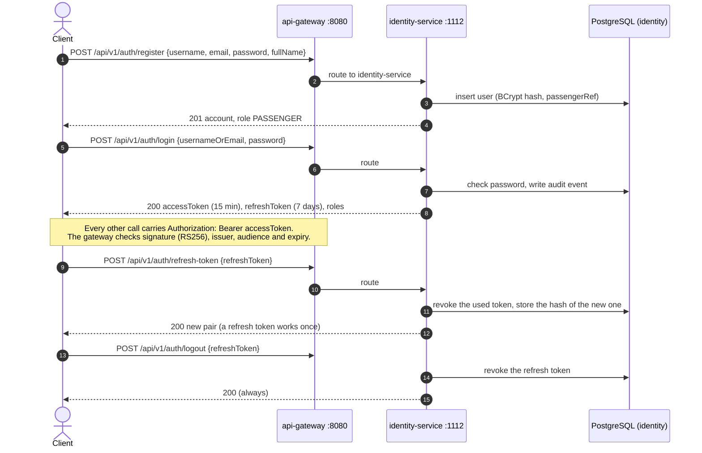
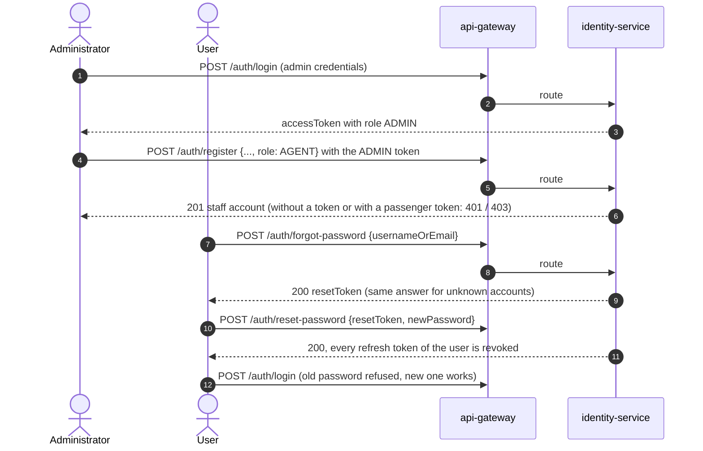
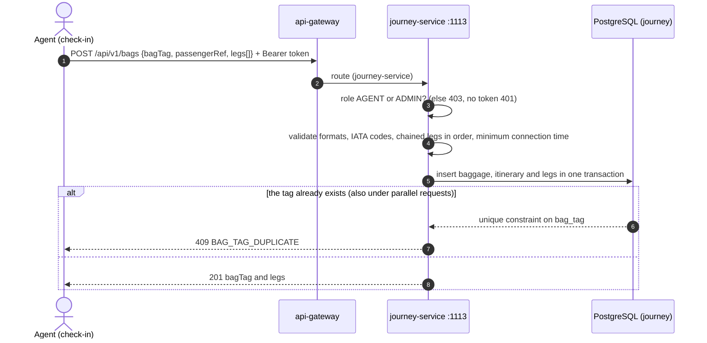
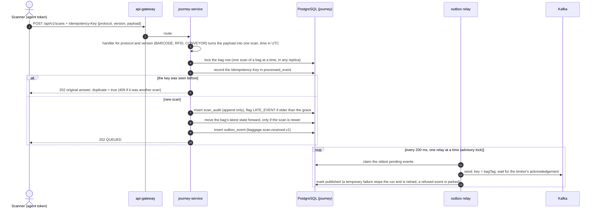
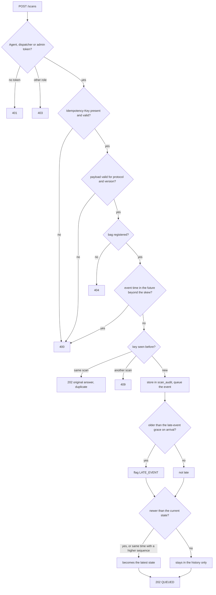
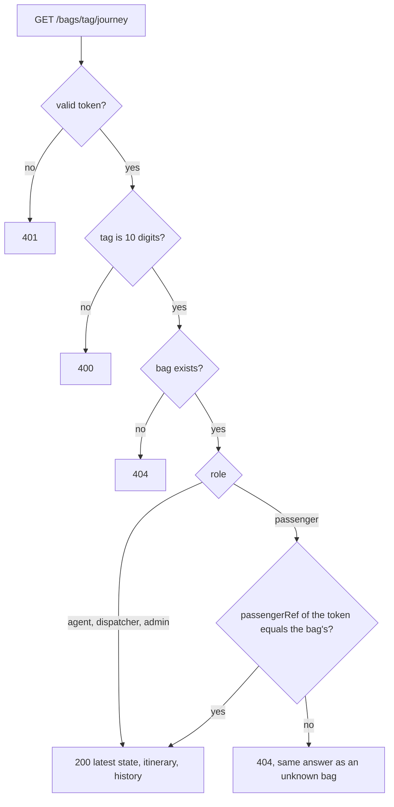
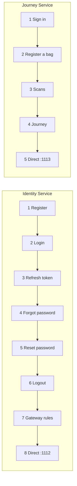

# API requests and flows

What the platform offers today, how a request flows through it, and how to try it in Postman.

**At a glance**

- Clients call the **api-gateway** at `http://localhost:8080`.
- `/api/v1/auth/**` goes to the **identity-service** (port 1112).
- `/api/v1/bags/**` and `/api/v1/scans/**` go to the **journey-service** (port 1113).
- Success answers look like `{"success":true,"data":...,"timestamp":...}`. Errors use the shared shape. See [API response format](../README.md#api-response-format).
- Limits and lockout of the login endpoints are in the [README](../README.md#rate-limits-and-lockout-of-the-authentication-endpoints).

**Contents:** [Identity Service API](#identity-service-api) · [Journey Service API](#journey-service-api) · [Flows](#flows) · [Postman collection](#postman-collection) · [Every request in the collection](#every-request-in-the-collection)

## Identity Service API

Base path: `/api/v1/auth`.

- Through the gateway: `http://localhost:8080/api/v1/auth`
- Directly: `http://localhost:1112/api/v1/auth`

| Call | Body | What it does |
|---|---|---|
| `POST /register` | `username`, `email`, `password`, `fullName`, `role` (optional) | Creates an account (201). Without a token, only `PASSENGER`. `AGENT`, `DISPATCHER` and `ADMIN` need an ADMIN access token |
| `POST /login` | `usernameOrEmail`, `password` | Returns `accessToken`, `refreshToken`, `tokenType`, the expiry times and the roles |
| `POST /refresh-token` | `refreshToken` | Returns a new token pair. A refresh token works once. Using a used one ends every session of that user |
| `POST /forgot-password` | `usernameOrEmail` | Starts a password reset. The answer is the same for unknown accounts |
| `POST /reset-password` | `resetToken`, `newPassword` | Sets a new password. The reset token works once, for 15 minutes. Every session of the user ends |
| `POST /logout` | `refreshToken` | Revokes the refresh token. Always answers 200 |

### Tokens and keys

- Passwords are 12 to 72 bytes.
- An access token is valid for 15 minutes, a refresh token for 7 days.
- A refresh token is a signed JWT (RS256, same issuer) with its own audience. It is refused as an access token, and the other way round.
- Refresh and reset tokens are stored only as SHA-256 hashes.
- Tokens are signed with a **development key pair** that ships with identity-service. Its private key is in this repository, so anyone can create valid tokens. Use it only for a local stack. identity-service logs a warning at every start while it is in use.

To use your own key pair:

1. Create it:

   ```bash
   openssl genpkey -algorithm RSA -pkeyopt rsa_keygen_bits:2048 -out private.pem
   openssl rsa -in private.pem -pubout -out public.pem
   ```

2. Mount the files into the containers.
3. Set the paths, for example `file:/run/secrets/private.pem`:
   - identity-service: `IDENTITY_JWT_PRIVATE_KEY_LOCATION` and `IDENTITY_JWT_PUBLIC_KEY_LOCATION`
   - api-gateway: `JWT_PUBLIC_KEY_LOCATION` (public key only)
   - journey-service: `IDENTITY_JWT_PUBLIC_KEY_LOCATION` (public key only)

There is no key-set (JWKS) endpoint and no issuer setting.

## Journey Service API

Port 1113, schema `journey` in PostgreSQL. It registers bags with an itinerary, takes in scans and shows the journey of a bag.

- Through the gateway the calls are under `/api/v1/bags` and `/api/v1/scans`.
- All calls need a bearer token.
- Answers are wrapped as `{"success":true,"data":...,"timestamp":...}`.

| Call | Roles | What it does |
|---|---|---|
| `POST /api/v1/bags` with `bagTag`, `passengerRef`, `legs[]` | AGENT, ADMIN | Registers a bag (201). `bagTag` is 10 digits and unique (`409 BAG_TAG_DUPLICATE`). Airports are 3-letter IATA codes. Legs must be chained, in order, and respect the minimum connection time (`JOURNEY_MIN_CONNECTION_TIME`, default `45m`) |
| `GET /api/v1/bags/{bagTag}/journey` | all roles | Returns the latest accepted state and the immutable scan history. A passenger sees only a bag registered to their own `passengerRef`. Any other bag answers `404`, like an unknown one |
| `POST /api/v1/scans` with `protocol`, `version` (optional), `payload`, and an `Idempotency-Key` header | AGENT, DISPATCHER, ADMIN | Accepts a scan (202 `QUEUED`) and queues the event `baggage.scan.received.v1` |

### Scans

- `protocol` is `BARCODE`, `RFID` or `CONVEYOR`. Each has its own payload format. See the handlers in `journey-service/.../scan`.
- Send the same `Idempotency-Key` again and you get the original answer. Nothing new is created.
- The same key for a different scan is a `409`.
- Times are stored in UTC, with the zone the device reported.
- A scan older than `JOURNEY_LATE_EVENT_GRACE` (default `10m`) on arrival is flagged `lateEvent`. It is kept and published, but it never replaces a newer state.

### How events are published

- Each scan stores an event in an outbox, in the same transaction as the scan.
- A relay sends the events to Kafka at least once. The key is the bag tag. It runs every `JOURNEY_OUTBOX_RELAY_DELAY` (default `200ms`).
- One relay runs at a time across all replicas (a PostgreSQL advisory lock). The events of one bag stay in order.
- A temporary Kafka problem stops the run. The relay tries again.
- An event the broker refuses for good (for example too large) is parked and counted in `journey.outbox.parked`.

### Known limitations

- Scans must come from a staff account. There is no device identity yet.
- One relay sends at a time. Throughput is one stream.
- A journey lists at most the newest 500 scans. `historyTruncated` says so.
- Tokens are checked with one static identity public key. There is no key set and no rotation. If no key is configured, the bundled development key is used.

## Flows

The diagrams are Mermaid. GitHub and IntelliJ render them.

### 1. Passenger: register, sign in, call the API, refresh, sign out



A refresh token that was already used (more than 10 seconds ago) and is presented again counts as theft. Every session of that user ends.

### 2. Staff accounts and password reset



### 3. Journey: register a bag



### 4. Journey: ingest a scan (idempotent) and publish the event



### 5. Journey: what happens to a scan



### 6. Journey: who sees which bag



## Postman collection

Two files in `postman/`:

- `AeroTrace.postman_collection.json`
- `AeroTrace-local.postman_environment.json`

**Set up**

1. Start the stack with Docker Compose. The `dev` Liquibase context creates the dummy accounts.
2. Import both files into Postman.
3. Select the environment "AeroTrace - local". `baseUrl` is `http://localhost:8080`.
4. Run a service folder from top to bottom. Use a delay of 150 ms or more between requests. The gateway allows about 10 requests per second per address.

**Folders**

| Folder | Steps |
|---|---|
| Identity Service | 1 Register, 2 Login, 3 Refresh token, 4 Forgot password, 5 Reset password, 6 Logout, 7 Gateway rules, 8 Direct calls to port 1112 (`identityUrl`) |
| Journey Service | 1 Sign in, 2 Register a bag, 3 Scans, 4 Journey, 5 Direct calls to port 1113 (`journeyUrl`) |

**Identity Service**

- 1 Register creates a passenger. The later folders log in, refresh, reset the password and log out.
- The test scripts store the tokens in the environment.
- The refusals (wrong password, validation, duplicate, unknown tokens) are in the same folders.
- 1.2 (register staff) needs `adminUsername` and `adminPassword` in the environment. By default this is the dev dummy admin. You can also make the first admin by hand, see the [README](../README.md#first-administrator-without-the-dev-context).

**Journey Service** (see [Journey Service API](#journey-service-api))

- Signs in the dev dummy agent and two dummy passengers. Variables: `journeyAgentUsername`, `journeyPassengerUsername`, `journeyOtherPassengerUsername`, `journeyAgentPassword`, `journeyPassengerPassword`.
- Registers a bag.
- Sends barcode, RFID and conveyor scans. An `Idempotency-Key` is generated for each scan.
- Reads the journey as staff, as the owner and as another passenger.
- Checks the refusals.
- Needs the Compose stack with the `dev` Liquibase context, like Identity Service 1.2.

**With newman**

```bash
newman run postman/AeroTrace.postman_collection.json -e postman/AeroTrace-local.postman_environment.json --delay-request 150 --folder "Identity Service"
```

Use `--folder "Journey Service"` for the journey folder.

Run order of the collection:



## Every request in the collection

Generated from `postman/AeroTrace.postman_collection.json`.

- **Step** is the number in front of the request name in Postman.
- Paths go through the gateway, unless marked direct.
- **Expect** is the status the test script checks.

### Identity Service

#### 1. Register

**1.1 Passenger (public, no token)**

| Step | Request | Call | Expect |
|---|---|---|---|
| 1.1.1 | Register passenger | `POST /api/v1/auth/register` | 201 |
| 1.1.2 | Register passenger with the PASSENGER role spelled out | `POST /api/v1/auth/register` | 201 |

**1.2 Staff (needs an ADMIN token)**

| Step | Request | Call | Expect |
|---|---|---|---|
| 1.2.1 | Register agent | `POST /api/v1/auth/register` | 201 |
| 1.2.2 | Register dispatcher | `POST /api/v1/auth/register` | 201 |
| 1.2.3 | Register administrator | `POST /api/v1/auth/register` | 201 |

**1.3 Refusals**

| Step | Request | Call | Expect |
|---|---|---|---|
| 1.3.1 | Register with a weak password | `POST /api/v1/auth/register` | 400 |
| 1.3.2 | Register with empty fields | `POST /api/v1/auth/register` | 400 |
| 1.3.3 | Register with an invalid email | `POST /api/v1/auth/register` | 400 |
| 1.3.4 | Register with an unknown role | `POST /api/v1/auth/register` | 400 |
| 1.3.5 | Register a duplicate username | `POST /api/v1/auth/register` | 409 |
| 1.3.6 | Register a duplicate email | `POST /api/v1/auth/register` | 409 |
| 1.3.7 | Register a staff role without a token | `POST /api/v1/auth/register` | 401 |
| 1.3.8 | Register a staff role with a passenger token | `POST /api/v1/auth/register` | 403 |

#### 2. Login

**2.1 Passenger**

| Step | Request | Call | Expect |
|---|---|---|---|
| 2.1.1 | Login | `POST /api/v1/auth/login` | 200 |
| 2.1.2 | Login with the email address | `POST /api/v1/auth/login` | 200 |

**2.2 Staff**

| Step | Request | Call | Expect |
|---|---|---|---|
| 2.2.1 | Login as the agent | `POST /api/v1/auth/login` | 200 |
| 2.2.2 | Login as the dispatcher | `POST /api/v1/auth/login` | 200 |
| 2.2.3 | Login as the new administrator | `POST /api/v1/auth/login` | 200 |
| 2.2.4 | Login as the configured administrator | `POST /api/v1/auth/login` | 200 |

**2.3 Refusals**

| Step | Request | Call | Expect |
|---|---|---|---|
| 2.3.1 | Login with a wrong password | `POST /api/v1/auth/login` | 401 |
| 2.3.2 | Login as an unknown user | `POST /api/v1/auth/login` | 401 |
| 2.3.3 | Login with empty fields | `POST /api/v1/auth/login` | 400 |

#### 3. Refresh token

| Step | Request | Call | Expect |
|---|---|---|---|
| 3.1 | Refresh token (rotation) | `POST /api/v1/auth/refresh-token` | 200 |
| 3.2 | Refresh token again with the used-up token (refused) | `POST /api/v1/auth/refresh-token` | 401 |
| 3.3 | Refresh with an unknown token | `POST /api/v1/auth/refresh-token` | 401 |
| 3.4 | Refresh with an empty body | `POST /api/v1/auth/refresh-token` | 400 |
| 3.5 | Refresh with an access token (refused) | `POST /api/v1/auth/refresh-token` | 401 |
| 3.6 | Use the refresh token as an access token (refused) | `POST /api/v1/auth/register` | 401 |

#### 4. Forgot password

| Step | Request | Call | Expect |
|---|---|---|---|
| 4.1 | Forgot password (existing account) | `POST /api/v1/auth/forgot-password` | 200 |
| 4.2 | Forgot password for an unknown account | `POST /api/v1/auth/forgot-password` | 200 |
| 4.3 | Forgot password with an empty body | `POST /api/v1/auth/forgot-password` | 400 |

#### 5. Reset password

| Step | Request | Call | Expect |
|---|---|---|---|
| 5.1 | Reset password with a weak new password | `POST /api/v1/auth/reset-password` | 400 |
| 5.2 | Reset password | `POST /api/v1/auth/reset-password` | 200 |
| 5.3 | Reset password again with the used token | `POST /api/v1/auth/reset-password` | 400 |
| 5.4 | Reset password with an unknown token | `POST /api/v1/auth/reset-password` | 400 |
| 5.5 | Refresh after the reset (refused) | `POST /api/v1/auth/refresh-token` | 401 |
| 5.6 | Login with the old password (refused) | `POST /api/v1/auth/login` | 401 |
| 5.7 | Login with the new password | `POST /api/v1/auth/login` | 200 |

#### 6. Logout

| Step | Request | Call | Expect |
|---|---|---|---|
| 6.1 | Logout | `POST /api/v1/auth/logout` | 200 |
| 6.2 | Logout again (still 200) | `POST /api/v1/auth/logout` | 200 |
| 6.3 | Refresh after logout (refused) | `POST /api/v1/auth/refresh-token` | 401 |
| 6.4 | Logout with an unknown token (still 200) | `POST /api/v1/auth/logout` | 200 |

#### 7. Gateway rules

| Step | Request | Call | Expect |
|---|---|---|---|
| 7.1 | A path that is not exposed (GET /me) | `GET /api/v1/auth/me` | 401 |

#### 8. Identity service direct (port 1112)

| Step | Request | Call | Expect |
|---|---|---|---|
| 8.1 | Health | `GET /actuator/health` (direct :1112) | 200 |
| 8.2 | Login directly | `POST /api/v1/auth/login` (direct :1112) | 401 |

### Journey Service

#### 1. Sign in (dev dummy accounts)

| Step | Request | Call | Expect |
|---|---|---|---|
| 1.1 | Agent | `POST /api/v1/auth/login` | 200 |
| 1.2 | Passenger (owner of the bag) | `POST /api/v1/auth/login` | 200 |
| 1.3 | Other passenger | `POST /api/v1/auth/login` | 200 |

#### 2. Register a bag

| Step | Request | Call | Expect |
|---|---|---|---|
| 2.1 | Register a bag | `POST /api/v1/bags` | 201 |
| 2.2 | Register the same tag again (refused) | `POST /api/v1/bags` | 409 |
| 2.3 | Invalid tag (refused) | `POST /api/v1/bags` | 400 |
| 2.4 | Connection shorter than the minimum (refused) | `POST /api/v1/bags` | 400 |
| 2.5 | As a passenger (refused) | `POST /api/v1/bags` | 403 |
| 2.6 | Without a token (refused) | `POST /api/v1/bags` | 401 |

#### 3. Scans

| Step | Request | Call | Expect |
|---|---|---|---|
| 3.1 | Barcode scan (CHECK_IN) | `POST /api/v1/scans` | 202 |
| 3.2 | Same Idempotency-Key again (original answer) | `POST /api/v1/scans` | 202 |
| 3.3 | Same Idempotency-Key for another scan (refused) | `POST /api/v1/scans` | 409 |
| 3.4 | RFID scan (SORTING) | `POST /api/v1/scans` | 202 |
| 3.5 | Conveyor scan (LOADED) | `POST /api/v1/scans` | 202 |
| 3.6 | A late scan (flagged LATE_EVENT, state unchanged) | `POST /api/v1/scans` | 202 |
| 3.7 | Without an Idempotency-Key (refused) | `POST /api/v1/scans` | 400 |
| 3.8 | A bag that is not registered (refused) | `POST /api/v1/scans` | 404 |
| 3.9 | As a passenger (refused) | `POST /api/v1/scans` | 403 |
| 3.10 | Without a token (refused) | `POST /api/v1/scans` | 401 |

#### 4. Journey

| Step | Request | Call | Expect |
|---|---|---|---|
| 4.1 | As the agent | `GET /api/v1/bags/{journeyBagTag}/journey` | 200 |
| 4.2 | As the passenger who owns the bag | `GET /api/v1/bags/{journeyBagTag}/journey` | 200 |
| 4.3 | As another passenger (404, like an unknown bag) | `GET /api/v1/bags/{journeyBagTag}/journey` | 404 |
| 4.4 | Without a token (refused) | `GET /api/v1/bags/{journeyBagTag}/journey` | 401 |
| 4.5 | A malformed bag tag (refused) | `GET /api/v1/bags/12345/journey` | 400 |

#### 5. Journey service direct (port 1113)

| Step | Request | Call | Expect |
|---|---|---|---|
| 5.1 | Health | `GET /actuator/health` (direct :1113) | 200 |
| 5.2 | OpenAPI definition | `GET /v3/api-docs` (direct :1113) | 200 |
