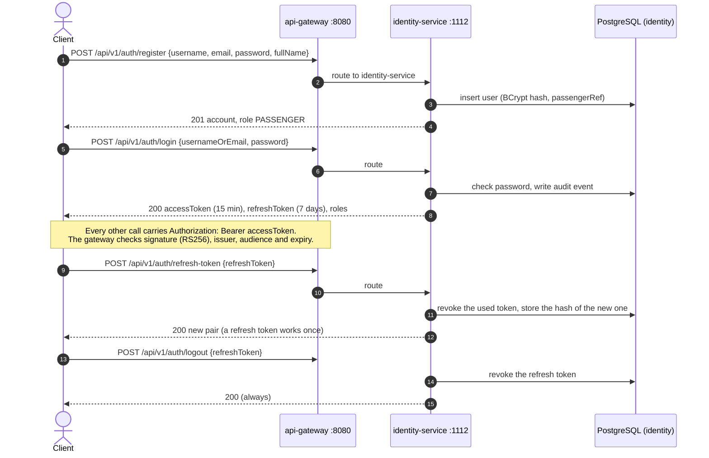
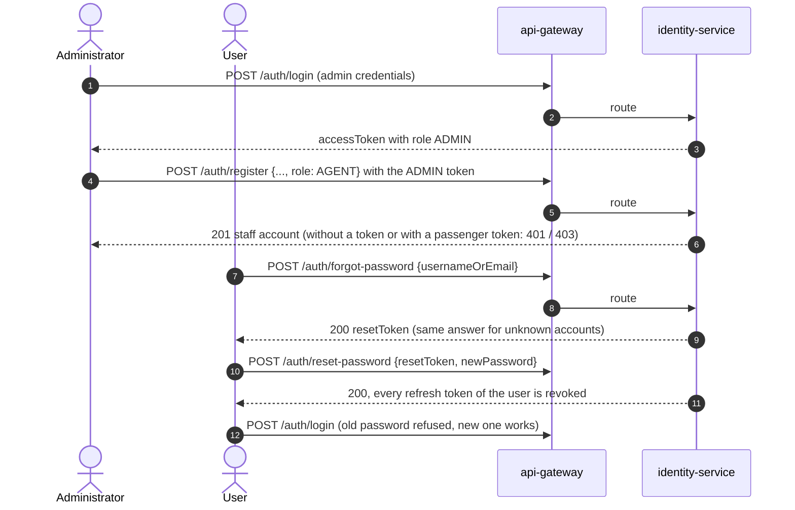

# Identity Service API

[← API overview](API.md) · [Journey Service API](JOURNEY-API.md) · [README](../README.md)

Registers users, signs them in and issues signed tokens.

**Contents:** [At a glance](#at-a-glance) · [Calls](#calls) · [Tokens and keys](#tokens-and-keys) · [Flows](#flows) · [Every request in the Postman collection](#every-request-in-the-postman-collection)

## At a glance

| Topic | Value |
|---|---|
| Through the gateway | `http://localhost:8080/api/v1/auth` |
| Directly | `http://localhost:1112/api/v1/auth` |
| Database | PostgreSQL, schema `identity` |
| Answers | `{"success":true,"data":...,"timestamp":...}`. Errors use the shared shape, see [API response format](../README.md#api-response-format) |
| Limits and lockout | See the [README](../README.md#rate-limits-and-lockout-of-the-authentication-endpoints) |

## Calls

| Call | Body | What it does |
|---|---|---|
| `POST /register` | `username`, `email`, `password`, `fullName`, `role` (optional) | Creates an account (201). Without a token, only `PASSENGER`. `AGENT`, `DISPATCHER` and `ADMIN` need an ADMIN access token |
| `POST /login` | `usernameOrEmail`, `password` | Returns `accessToken`, `refreshToken`, `tokenType`, the expiry times and the roles |
| `POST /refresh-token` | `refreshToken` | Returns a new token pair. A refresh token works once. Using a used one ends every session of that user |
| `POST /forgot-password` | `usernameOrEmail` | Starts a password reset. The answer is the same for unknown accounts |
| `POST /reset-password` | `resetToken`, `newPassword` | Sets a new password. The reset token works once, for 15 minutes. Every session of the user ends |
| `POST /logout` | `refreshToken` | Revokes the refresh token. Always answers 200 |

Which calls need a token:

| Call | Token |
|---|---|
| `register` (passenger), `login`, `refresh-token`, `forgot-password`, `reset-password`, `logout` | none |
| `register` (staff role) | ADMIN access token |

## Tokens and keys

| Topic | Rule |
|---|---|
| Passwords | 12 to 72 bytes |
| Access token | Valid for 15 minutes |
| Refresh token | Valid for 7 days. A signed JWT (RS256, same issuer) with its own audience. It is refused as an access token, and the other way round |
| Storage | Refresh and reset tokens are stored only as SHA-256 hashes |
| Development key pair | Ships with identity-service. Its private key is in this repository, so anyone can create valid tokens. Use it only for a local stack. A warning is logged at every start while it is in use |
| Key set | There is no key-set (JWKS) endpoint and no issuer setting |

To use your own key pair:

1. Create it:

   ```bash
   openssl genpkey -algorithm RSA -pkeyopt rsa_keygen_bits:2048 -out private.pem
   openssl rsa -in private.pem -pubout -out public.pem
   ```

2. Mount the files into the containers.
3. Set the paths (for example `file:/run/secrets/private.pem`):

| Service | Variables |
|---|---|
| identity-service | `IDENTITY_JWT_PRIVATE_KEY_LOCATION`, `IDENTITY_JWT_PUBLIC_KEY_LOCATION` |
| api-gateway | `JWT_PUBLIC_KEY_LOCATION` (public key only) |
| journey-service | `IDENTITY_JWT_PUBLIC_KEY_LOCATION` (public key only) |

## Flows

The diagrams are Mermaid. GitHub and IntelliJ render them.

### 1. Passenger: register, sign in, call the API, refresh, sign out



A refresh token that was already used (more than 10 seconds ago) and is presented again counts as theft. Every session of that user ends.

### 2. Staff accounts and password reset



## Every request in the Postman collection

Generated from `postman/AeroTrace.postman_collection.json`.

| Column | Meaning |
|---|---|
| Step | The number in front of the request name in Postman |
| Call | Path through the gateway, unless marked direct |
| Expect | The status the test script checks |

### 1. Register

**1.1 Passenger (public, no token)**

| Step | Request | Call | Expect |
|---|---|---|---|
| 1.1.1 | Register passenger | `POST /api/v1/auth/register` | 201 |
| 1.1.2 | Register passenger with the PASSENGER role spelled out | `POST /api/v1/auth/register` | 201 |

**1.2 Staff (needs an ADMIN token)**

| Step | Request | Call | Expect |
|---|---|---|---|
| 1.2.1 | Register agent | `POST /api/v1/auth/register` | 201 |
| 1.2.2 | Register dispatcher | `POST /api/v1/auth/register` | 201 |
| 1.2.3 | Register administrator | `POST /api/v1/auth/register` | 201 |

**1.3 Refusals**

| Step | Request | Call | Expect |
|---|---|---|---|
| 1.3.1 | Register with a weak password | `POST /api/v1/auth/register` | 400 |
| 1.3.2 | Register with empty fields | `POST /api/v1/auth/register` | 400 |
| 1.3.3 | Register with an invalid email | `POST /api/v1/auth/register` | 400 |
| 1.3.4 | Register with an unknown role | `POST /api/v1/auth/register` | 400 |
| 1.3.5 | Register a duplicate username | `POST /api/v1/auth/register` | 409 |
| 1.3.6 | Register a duplicate email | `POST /api/v1/auth/register` | 409 |
| 1.3.7 | Register a staff role without a token | `POST /api/v1/auth/register` | 401 |
| 1.3.8 | Register a staff role with a passenger token | `POST /api/v1/auth/register` | 403 |

### 2. Login

**2.1 Passenger**

| Step | Request | Call | Expect |
|---|---|---|---|
| 2.1.1 | Login | `POST /api/v1/auth/login` | 200 |
| 2.1.2 | Login with the email address | `POST /api/v1/auth/login` | 200 |

**2.2 Staff**

| Step | Request | Call | Expect |
|---|---|---|---|
| 2.2.1 | Login as the agent | `POST /api/v1/auth/login` | 200 |
| 2.2.2 | Login as the dispatcher | `POST /api/v1/auth/login` | 200 |
| 2.2.3 | Login as the new administrator | `POST /api/v1/auth/login` | 200 |
| 2.2.4 | Login as the configured administrator | `POST /api/v1/auth/login` | 200 |

**2.3 Refusals**

| Step | Request | Call | Expect |
|---|---|---|---|
| 2.3.1 | Login with a wrong password | `POST /api/v1/auth/login` | 401 |
| 2.3.2 | Login as an unknown user | `POST /api/v1/auth/login` | 401 |
| 2.3.3 | Login with empty fields | `POST /api/v1/auth/login` | 400 |

### 3. Refresh token

| Step | Request | Call | Expect |
|---|---|---|---|
| 3.1 | Refresh token (rotation) | `POST /api/v1/auth/refresh-token` | 200 |
| 3.2 | Refresh token again with the used-up token (refused) | `POST /api/v1/auth/refresh-token` | 401 |
| 3.3 | Refresh with an unknown token | `POST /api/v1/auth/refresh-token` | 401 |
| 3.4 | Refresh with an empty body | `POST /api/v1/auth/refresh-token` | 400 |
| 3.5 | Refresh with an access token (refused) | `POST /api/v1/auth/refresh-token` | 401 |
| 3.6 | Use the refresh token as an access token (refused) | `POST /api/v1/auth/register` | 401 |

### 4. Forgot password

| Step | Request | Call | Expect |
|---|---|---|---|
| 4.1 | Forgot password (existing account) | `POST /api/v1/auth/forgot-password` | 200 |
| 4.2 | Forgot password for an unknown account | `POST /api/v1/auth/forgot-password` | 200 |
| 4.3 | Forgot password with an empty body | `POST /api/v1/auth/forgot-password` | 400 |

### 5. Reset password

| Step | Request | Call | Expect |
|---|---|---|---|
| 5.1 | Reset password with a weak new password | `POST /api/v1/auth/reset-password` | 400 |
| 5.2 | Reset password | `POST /api/v1/auth/reset-password` | 200 |
| 5.3 | Reset password again with the used token | `POST /api/v1/auth/reset-password` | 400 |
| 5.4 | Reset password with an unknown token | `POST /api/v1/auth/reset-password` | 400 |
| 5.5 | Refresh after the reset (refused) | `POST /api/v1/auth/refresh-token` | 401 |
| 5.6 | Login with the old password (refused) | `POST /api/v1/auth/login` | 401 |
| 5.7 | Login with the new password | `POST /api/v1/auth/login` | 200 |

### 6. Logout

| Step | Request | Call | Expect |
|---|---|---|---|
| 6.1 | Logout | `POST /api/v1/auth/logout` | 200 |
| 6.2 | Logout again (still 200) | `POST /api/v1/auth/logout` | 200 |
| 6.3 | Refresh after logout (refused) | `POST /api/v1/auth/refresh-token` | 401 |
| 6.4 | Logout with an unknown token (still 200) | `POST /api/v1/auth/logout` | 200 |

### 7. Gateway rules

| Step | Request | Call | Expect |
|---|---|---|---|
| 7.1 | A path that is not exposed (GET /me) | `GET /api/v1/auth/me` | 401 |

### 8. Identity service direct (port 1112)

| Step | Request | Call | Expect |
|---|---|---|---|
| 8.1 | Health | `GET /actuator/health` (direct :1112) | 200 |
| 8.2 | Login directly | `POST /api/v1/auth/login` (direct :1112) | 401 |
