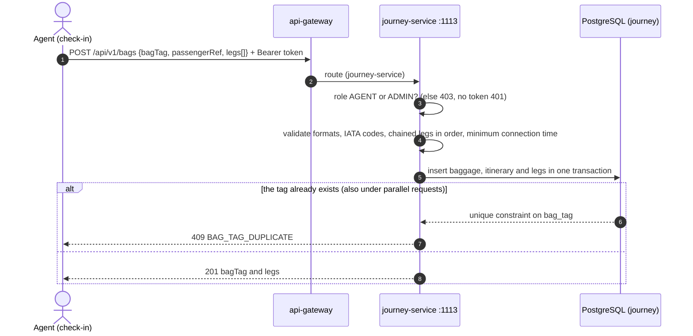
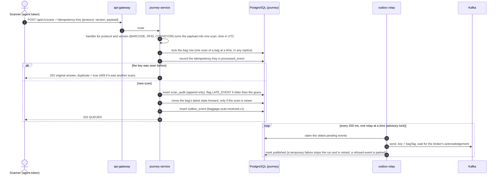
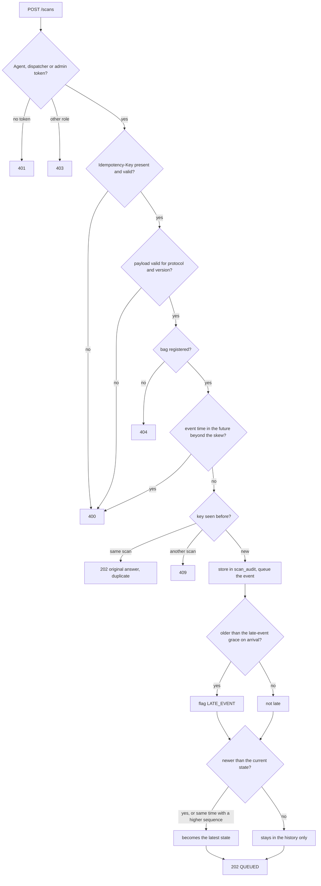
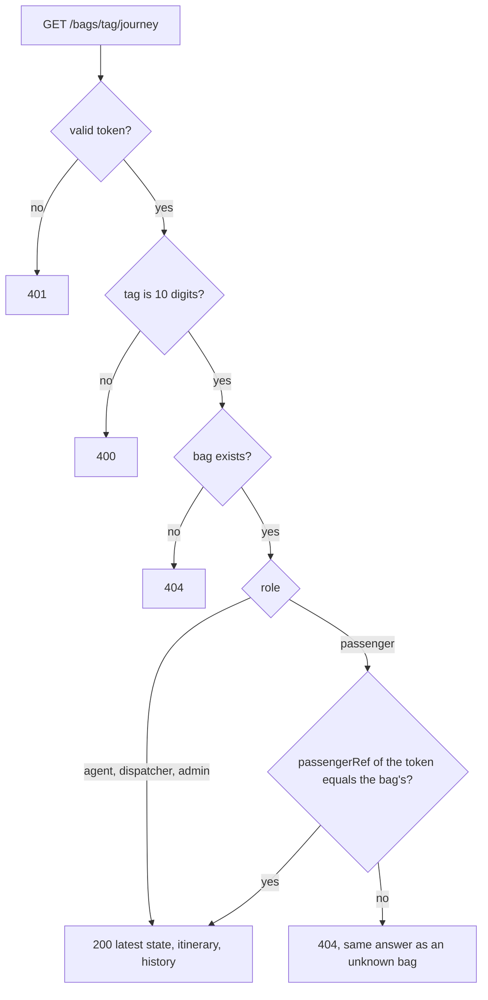

# Journey Service API

[← API overview](API.md) · [Identity Service API](IDENTITY-API.md) · [README](../README.md)

Registers bags with an itinerary, takes in scans from devices and shows the journey of a bag.

**Contents:** [At a glance](#at-a-glance) · [Calls](#calls) · [Rules](#rules) · [Scan formats](#scan-formats) · [Errors](#errors) · [How events are published](#how-events-are-published) · [Known limitations](#known-limitations) · [Flows](#flows) · [Every request in the Postman collection](#every-request-in-the-postman-collection)

## At a glance

| Topic | Value |
|---|---|
| Through the gateway | `http://localhost:8080/api/v1/bags` and `/api/v1/scans` |
| Directly | `http://localhost:1113` |
| Database | PostgreSQL, schema `journey` |
| Messages | Kafka topic `baggage.scan.received.v1`, key = bag tag |
| Token | All calls need a bearer token from the [Identity Service](IDENTITY-API.md) |
| Answers | `{"success":true,"data":...,"timestamp":...}`. Errors use the shared shape, see [API response format](../README.md#api-response-format) |

## Calls

| Call | Roles | What it does |
|---|---|---|
| `POST /api/v1/bags` with `bagTag`, `passengerRef`, `legs[]` | AGENT, ADMIN | Registers a bag (201) |
| `GET /api/v1/bags/{bagTag}/journey` | all roles | Returns the latest accepted state and the immutable scan history |
| `POST /api/v1/scans` with `protocol`, `version` (optional), `payload`, and an `Idempotency-Key` header | AGENT, DISPATCHER, ADMIN | Accepts a scan (202 `QUEUED`) and queues the event |

## Rules

**Registering a bag**

| Topic | Rule |
|---|---|
| Bag tag | 10 digits, unique. A second registration is `409 BAG_TAG_DUPLICATE`, also under parallel requests |
| Passenger reference | `P-` and 20 digits (the `passengerRef` claim of the passenger token) |
| Airports | 3-letter uppercase IATA codes. A leg must leave and arrive at different airports |
| Legs | 1 to 8. Each leg arrives after it departs. Each leg starts where the previous one ended. Legs are in order |
| Connection time | At least `JOURNEY_MIN_CONNECTION_TIME` between two legs. Default `45m` |

**Reading a journey**

| Topic | Rule |
|---|---|
| Content | The latest accepted state, the itinerary and the scan history in event order |
| Staff | AGENT, DISPATCHER and ADMIN see every bag |
| Passengers | A passenger sees only a bag registered to their own `passengerRef`. Any other bag answers `404`, like an unknown one |
| Size | At most the newest 500 scans. `historyTruncated` says when older ones are left out |

**Scans**

| Topic | Rule |
|---|---|
| Idempotency-Key | Required. 1 to 128 visible characters. Send the same key again and you get the original answer (`duplicate: true`). Nothing new is created |
| Same key, different scan | `409 VERSION_CONFLICT`. Nothing of the first scan is revealed |
| Time | Stored in UTC, with the zone the device reported |
| Future | A scan stamped more than `JOURNEY_MAX_CLOCK_SKEW` (default `5m`) ahead is refused (400) |
| Late scan | Older than `JOURNEY_LATE_EVENT_GRACE` (default `10m`) on arrival: flagged `lateEvent`. It is kept and published, but never replaces a newer state |
| Latest state | The scan with the newest event time wins. For the same time, the higher device sequence wins. The arrival order does not matter |
| Unknown bag | `404` |
| Size | The payload has at most 20 fields |

## Scan formats

`protocol` is `BARCODE`, `RFID` or `CONVEYOR`. `version` defaults to 1. Other versions are refused (400).

| Protocol | Payload fields |
|---|---|
| `BARCODE` | `bagTag`, `airport`, `checkpoint`, `sequence`, `scannedAt` (ISO-8601 time with offset, for example `2026-11-14T08:15:00+02:00`) |
| `RFID` | `tagId` (the bag tag), `airport`, `checkpoint`, `readCount`, `readAt` (epoch milliseconds), `timezone` (IANA zone, for example `Europe/Istanbul`) |
| `CONVEYOR` | `bagTag`, `airport`, `checkpoint`, `seq`, `timestamp` (local time without offset, for example `2026-11-14T08:15:00`), `timezone` (IANA zone) |

`checkpoint` is one of: `CHECK_IN`, `SORTING`, `TRANSFER`, `LOADED`, `ARRIVED`, `CLAIM`. The sequence or count is a number of 0 or more.

## Errors

| Status | `code` | When |
|---|---|---|
| 400 | `VALIDATION_ERROR` | A field, the itinerary, the payload, the scan version or the Idempotency-Key is invalid |
| 401 | `UNAUTHENTICATED` | No token, or an invalid or expired one |
| 403 | `ACCESS_DENIED` | The token's role may not make this call |
| 404 | `NOT_FOUND` | Unknown bag. Also another passenger's bag |
| 409 | `BAG_TAG_DUPLICATE` | The bag tag is already registered |
| 409 | `VERSION_CONFLICT` | The Idempotency-Key was already used for a different scan |

## How events are published

| Topic | What happens |
|---|---|
| Outbox | Each scan stores an event in an outbox, in the same transaction as the scan |
| Relay | Sends the events to Kafka at least once. The key is the bag tag. It runs every `JOURNEY_OUTBOX_RELAY_DELAY` (default `200ms`) |
| Order | One relay runs at a time across all replicas (a PostgreSQL advisory lock). The events of one bag stay in order |
| Temporary Kafka problem | The run stops. The relay tries again |
| Event refused for good | For example too large. It is parked and counted in `journey.outbox.parked` |

## Known limitations

| Area | Limitation |
|---|---|
| Scanners | Scans must come from a staff account. There is no device identity yet |
| Throughput | One relay sends at a time: one stream |
| History | A journey lists at most the newest 500 scans |
| Tokens | Checked with one static identity public key. There is no key set and no rotation. If no key is configured, the bundled development key is used |

## Flows

The diagrams are Mermaid. GitHub and IntelliJ render them.

### 1. Register a bag

### 2. Ingest a scan (idempotent) and publish the event

### 3. What happens to a scan

### 4. Who sees which bag

## Every request in the Postman collection

Generated from `postman/AeroTrace.postman_collection.json`.

| Column | Meaning |
|---|---|
| Step | The number in front of the request name in Postman |
| Call | Path through the gateway, unless marked direct |
| Expect | The status the test script checks |

### 1. Sign in (dev dummy accounts)

| Step | Request | Call | Expect |
|---|---|---|---|
| 1.1 | Agent | `POST /api/v1/auth/login` | 200 |
| 1.2 | Passenger (owner of the bag) | `POST /api/v1/auth/login` | 200 |
| 1.3 | Other passenger | `POST /api/v1/auth/login` | 200 |

### 2. Register a bag

| Step | Request | Call | Expect |
|---|---|---|---|
| 2.1 | Register a bag | `POST /api/v1/bags` | 201 |
| 2.2 | Register the same tag again (refused) | `POST /api/v1/bags` | 409 |
| 2.3 | Invalid tag (refused) | `POST /api/v1/bags` | 400 |
| 2.4 | Connection shorter than the minimum (refused) | `POST /api/v1/bags` | 400 |
| 2.5 | As a passenger (refused) | `POST /api/v1/bags` | 403 |
| 2.6 | Without a token (refused) | `POST /api/v1/bags` | 401 |

### 3. Scans

| Step | Request | Call | Expect |
|---|---|---|---|
| 3.1 | Barcode scan (CHECK_IN) | `POST /api/v1/scans` | 202 |
| 3.2 | Same Idempotency-Key again (original answer) | `POST /api/v1/scans` | 202 |
| 3.3 | Same Idempotency-Key for another scan (refused) | `POST /api/v1/scans` | 409 |
| 3.4 | RFID scan (SORTING) | `POST /api/v1/scans` | 202 |
| 3.5 | Conveyor scan (LOADED) | `POST /api/v1/scans` | 202 |
| 3.6 | A late scan (flagged LATE_EVENT, state unchanged) | `POST /api/v1/scans` | 202 |
| 3.7 | Without an Idempotency-Key (refused) | `POST /api/v1/scans` | 400 |
| 3.8 | A bag that is not registered (refused) | `POST /api/v1/scans` | 404 |
| 3.9 | As a passenger (refused) | `POST /api/v1/scans` | 403 |
| 3.10 | Without a token (refused) | `POST /api/v1/scans` | 401 |

### 4. Journey

| Step | Request | Call | Expect |
|---|---|---|---|
| 4.1 | As the agent | `GET /api/v1/bags/{journeyBagTag}/journey` | 200 |
| 4.2 | As the passenger who owns the bag | `GET /api/v1/bags/{journeyBagTag}/journey` | 200 |
| 4.3 | As another passenger (404, like an unknown bag) | `GET /api/v1/bags/{journeyBagTag}/journey` | 404 |
| 4.4 | Without a token (refused) | `GET /api/v1/bags/{journeyBagTag}/journey` | 401 |
| 4.5 | A malformed bag tag (refused) | `GET /api/v1/bags/12345/journey` | 400 |

### 5. Journey service direct (port 1113)

| Step | Request | Call | Expect |
|---|---|---|---|
| 5.1 | Health | `GET /actuator/health` (direct :1113) | 200 |
| 5.2 | OpenAPI definition | `GET /v3/api-docs` (direct :1113) | 200 |
