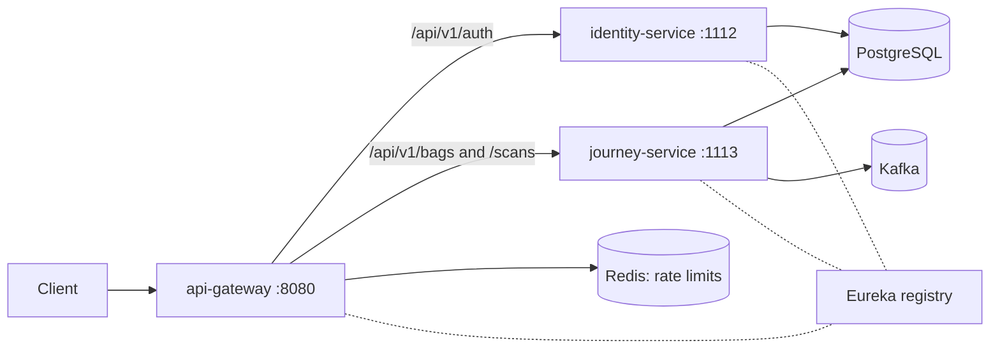
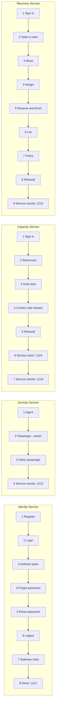

# API requests and flows

What the platform offers, how requests flow, how to try them in Postman.

## Documents

| Document | What it has |
|---|---|
| [Identity Service API](IDENTITY-API.md) | Calls, tokens, flows, requests |
| [Journey Service API](JOURNEY-API.md) | Calls, rules, scans, events, requests |
| [Recovery Service API](RECOVERY-API.md) | Cases, moves, capacity, policy, events |
| [Capacity Service API](CAPACITY-API.md) | Reservations, release, resources, the 409 contract, events |
| [Search Service API](SEARCH-API.md) | Bag search, airport report, index status, rebuild |
| [README](../../README.md) | Setup, variables, limits, observability |

## At a glance

| Service | Address | Gateway path |
|---|---|---|
| api-gateway | `http://localhost:8080` | clients call this |
| identity-service | `http://localhost:1112` | `/api/v1/auth/**` |
| journey-service | `http://localhost:1113` | `/api/v1/bags/**`, `/api/v1/scans/**` |
| recovery-service | `http://localhost:1115` | `/api/v1/recovery-cases/**`, `/api/v1/recovery-policy` |
| capacity-service | `http://localhost:1116` | `/api/v1/capacity/**` |
| search-service | `http://localhost:1117` | `/api/v1/search/**`, `/api/v1/reports/**`, `/api/v1/admin/search/**` |

Success answers look like `{"success":true,"data":...,"timestamp":...}`. Errors use the shared shape, see [response format](../../README.md#api-response-format).



## Postman collection

Two files in `postman/`:

| File | Content |
|---|---|
| `AeroTrace.postman_collection.json` | Requests with test scripts |
| `AeroTrace-local.postman_environment.json` | Variables: URLs, accounts, tokens |

**Set up**

1. Start the stack with Docker Compose. The `dev` context creates dummy accounts.
2. Import both files into Postman.
3. Select the environment "AeroTrace - local".
4. Run a service folder top to bottom, 150 ms or more between requests.

**Identity Service folders**

| Folder | What it does |
|---|---|
| 1 Register | Passenger, staff, refusals |
| 2 Login | Passenger, staff, refusals |
| 3 Refresh token | Rotation and refusals |
| 4 Forgot password | Starts a reset |
| 5 Reset password | Resets, then logs in again |
| 6 Logout | Revokes the refresh token |
| 7 Gateway rules | Unexposed paths are refused |
| 8 Direct (port 1112) | Health and login via `identityUrl` |

**Journey Service folders** (one per actor, in run order)

| Folder | What it does |
|---|---|
| 1 Agent (check-in desk) | Sign in, register a bag, send scans, read |
| 2 Passenger (owner of the bag) | Sign in, staff calls refused, read own journey |
| 3 Other passenger | Sign in, cannot read the bag |
| 4 Service checks (port 1113) | Health and OpenAPI via `journeyUrl` |

**Recovery Service folders** (run top to bottom)

| Folder | What it does |
|---|---|
| 1 Sign in | Agent, dispatcher, admin and passenger tokens |
| 2 Open a case (agent) | Opens a case; the same `Idempotency-Key` returns it again; a second open is refused; an invalid bag tag is refused |
| 3 Move the case (dispatcher) | `ASSESSING`; a retry with the same key; an old version, a skipped state, no reason and an unknown case are refused |
| 4 Assign a handler | Assigns the agent; assigning again changes nothing; a bad assignee and the admin are refused |
| 5 Reserve capacity and finish | Provisions 5 slots for the leg as the admin, `RESERVED` (200, a slot is held), checks one slot is held, cancel (the slot is back), a closed case is never reopened or given to another handler, a new case for the same leg is allowed |
| 6 List cases | State filter and paging, size capped at 100, an unknown state refused |
| 7 Recovery policy | Read, change as admin (an agent is refused, an old version is refused, an out-of-range value is refused), put it back |
| 8 Refused calls | No token 401; passenger and admin 403 where the role is not allowed |
| 9 Service checks (port 1115) | Health and OpenAPI via `recoveryUrl` |

**Capacity Service folders** (run top to bottom; the Recovery folder provisions its own leg, so the two are independent)

| Folder | What it does |
|---|---|
| 1 Sign in | Admin, agent, dispatcher and passenger tokens; a new leg id per run |
| 2 Resources (the admin sets capacity) | Create, read, set the same total again, refusals (agent, bad id, bad total, unknown), list; the answer shows who created and last changed the resource |
| 3 Hold slots (agent) | Hold, repeat, same id for another request, `Idempotency-Key`, full leg (`409 CAPACITY_EXCEEDED`), leg without a resource (`404 CAPACITY_NOT_PROVISIONED`), invalid, passenger and no token refused |
| 4 Confirm and release (dispatcher) | Confirm, release (once), a released hold does not hold again, a release before the hold leaves a tombstone, unknown ids, all slots back |
| 5 Refused calls | Passenger, dispatcher and no-token refusals, an unlisted path |
| 6 Service token (the recovery-service sweeper) | Confirm and release directly on port 1116 with `X-Service-Token` and no user token; the token cannot hold slots; a wrong token and the gateway are refused |
| 7 Service checks (port 1116) | Health and OpenAPI (the 409 contract) via `capacityUrl` |

**Search Service folders** (run top to bottom; see [Search Service API](SEARCH-API.md#every-request-in-the-postman-collection))

| Folder | What it does |
|---|---|
| 1 Sign in | Admin, dispatcher, agent and passenger tokens |
| 2 Search bags (agent) | First page, next page with the cursor, combined filters; size over 100 and a forged cursor refused |
| 3 Airport report (dispatcher) | Two zero-filled hours with `indexedThrough` and `lagSeconds`; `from` after `to` refused |
| 4 Index status (dispatcher) | Lag and read indexes; an agent refused |
| 5 Rebuild (admin) | Start, the same key returns the same job, read the job (ends `FAILED` until #28 and #29 add the export endpoints), a dispatcher refused |
| 6 Refused calls | Passenger on search and report, no token |

**Notes**

| Topic | What to know |
|---|---|
| Tokens | Test scripts store them in the environment |
| Recovery accounts | `recoveryAgentUsername`, `recoveryDispatcherUsername`, `recoveryAdminUsername`, `recoveryPassengerUsername` (the dev dummy accounts) and `recoveryPassword` |
| Recovery variables | The scripts fill `recoveryBagTag`, `recoveryLegId`, `recoveryCaseId`, `recoveryCaseVersion`, `recoveryCreateKey`, `recoveryMoveKey`, `recoveryAgentSubject`, `recoveryPolicyMinutes` and `recoveryPolicyVersion` |
| Recovery capacity | Request 5.1 provisions the leg in the capacity-service as the admin, so the capacity-service must be running (without it 5.2 answers 503) |
| Capacity variables | `capacityUrl` (port 1116), `capacityAdminUsername`, `capacityAgentUsername`, `capacityDispatcherUsername`, `capacityPassengerUsername`, `capacityPassword`, and `capacityServiceToken` (must equal `CAPACITY_SERVICE_TOKEN` of the stack; the Compose default is `aerotrace-local-service-token`) |
| Capacity values the scripts fill | `capacityAdminToken`, `capacityAgentToken`, `capacityDispatcherToken`, `capacityPassengerToken`, the three `...Subject` values (the user ids the audit columns record), `capacityLegId`, `capacityReservationId`, `capacityReservationId2`, `capacityUnheldId`, `capacityServiceHoldId`, `capacityCaseId`, `capacityBagTag`, `capacityIdempotencyKey`, `capacityCreatedAt`, `recoveryCapacityTotal` |
| Audit | The register answer (`createdBy`: the admin's user id, or `anonymous`) and the capacity resource answer (`createdBy`, `createdAt`, `updatedBy`, `updatedAt`) show who did it. The other services keep these columns in the database only (ADR 0003) |
| Auth rate limit | The gateway lets one address make 12 auth calls a minute (burst 10). The Identity folder alone makes about 35, so a full run needs a higher limit: put `AUTH_RATE_LIMIT_REPLENISH_RATE=100` and `AUTH_RATE_LIMIT_BURST_CAPACITY=1000` in `.env` and recreate the gateway. Without it the later requests answer `429` |
| Recovery policy | Folder 7 puts the policy back to the value it read, so a run leaves it unchanged |
| Identity 1.2 | Needs `adminUsername` and `adminPassword` |
| Default admin | The dev dummy admin |
| First admin | By hand, see [README](../../README.md#first-administrator-without-the-dev-context) |
| Journey scans | `Idempotency-Key` generated per scan |
| Journey | Needs Compose with the `dev` context |
| Journey variables | `journeyAgentUsername`, `journeyPassengerUsername`, `journeyOtherPassengerUsername` |
| Journey passwords | `journeyAgentPassword`, `journeyPassengerPassword` |
| Journey reference | `journeyPassengerRef`, seeded `P-00000000000000000001` |
| Base URL | `baseUrl` is `http://localhost:8080` |

**With newman**

```bash
newman run postman/AeroTrace.postman_collection.json -e postman/AeroTrace-local.postman_environment.json --delay-request 150 --folder "Identity Service"
```

Use `--folder "Journey Service"` for the journey folder, `--folder "Recovery Service"` for the recovery folder, `--folder "Capacity Service"` for the capacity folder and `--folder "Search Service"` for the search folder.

**Run order of the collection**



The tables of every request are in [Identity Service API](IDENTITY-API.md#every-request-in-the-postman-collection) and [Journey Service API](JOURNEY-API.md#every-request-in-the-postman-collection). The recovery requests are listed above and in [Recovery Service API](RECOVERY-API.md). The capacity requests are in [Capacity Service API](CAPACITY-API.md#every-request-in-the-postman-collection), the search requests in [Search Service API](SEARCH-API.md#every-request-in-the-postman-collection).
