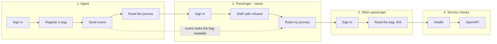
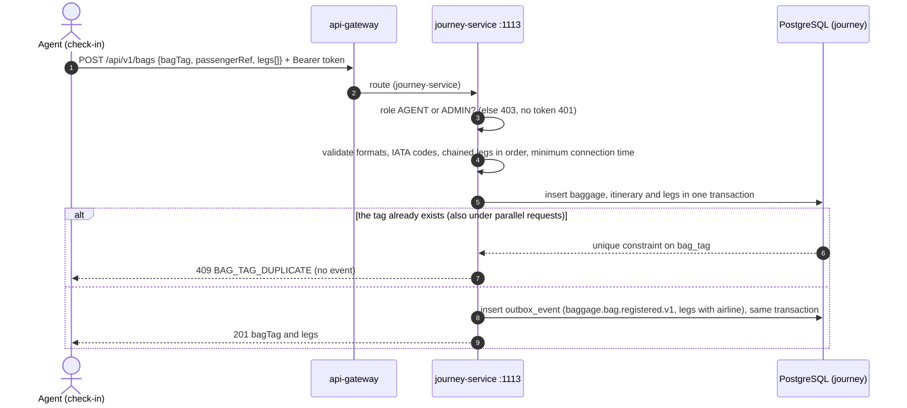
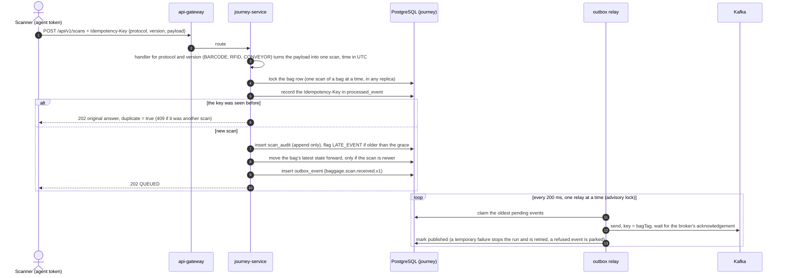
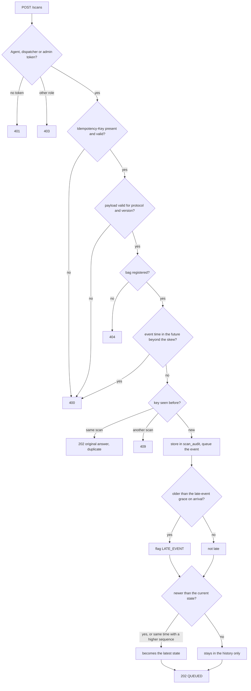
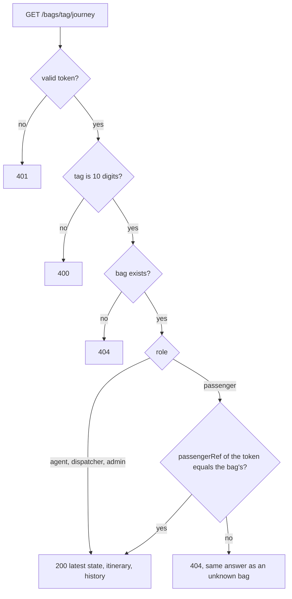

# Journey Service API

[← API overview](API.md) · [Identity Service API](IDENTITY-API.md) · [README](../../README.md)

Registers bags, takes in device scans, shows each bag's journey.

## Contents

| Section | What it covers |
|---|---|
| [At a glance](#at-a-glance) | Addresses, database, messages |
| [Calls](#calls) | The three requests |
| [Rules](#rules) | Registering, reading, scanning |
| [Scan formats](#scan-formats) | Payload fields per protocol |
| [Errors](#errors) | Status and code per case |
| [How events are published](#how-events-are-published) | Outbox and Kafka relay, the scan and registration events |
| [Internal export](#internal-export) | The read-only bag export for the search-service's rebuild |
| [Risk Streams Service (Kafka Streams)](#risk-streams-service-kafka-streams) | Who reads the scan event, what it publishes |
| [Metrics and traces](#metrics-and-traces) | What the dashboards read |
| [Known limitations](#known-limitations) | What is not done yet |
| [Postman flow by actor](#postman-flow-by-actor) | Agent, passenger, other passenger |
| [Flows](#flows) | Sequence and decision diagrams |
| [Every request](#every-request-in-the-postman-collection) | Postman requests, expected status |

## At a glance

| Topic | Value |
|---|---|
| Through the gateway | `http://localhost:8080/api/v1/bags` and `/api/v1/scans` |
| Directly | `http://localhost:1113` |
| Database | PostgreSQL, schema `journey` |
| Messages | Topics `baggage.scan.received.v1` and `baggage.bag.registered.v1`, key = bag tag |
| Token | Bearer token from [Identity Service](IDENTITY-API.md) |
| Success answer | `{"success":true,"data":...,"timestamp":...}` |
| Errors | Shared shape, see [response format](../../README.md#api-response-format) |

## Calls

| Call | Roles | What it does |
|---|---|---|
| `POST /api/v1/bags` | AGENT, ADMIN | Registers a bag (201) |
| `GET /api/v1/bags/{bagTag}/journey` | all roles | Returns latest state and scan history |
| `POST /api/v1/scans` | AGENT, DISPATCHER, ADMIN | Accepts a scan (202 `QUEUED`) |
| `GET /internal/v1/export/bags?after=&size=` | service token only, not routed by the gateway | Every bag with its legs and latest scan, for the search-service's rebuild ([below](#internal-export)) |

| Call | Body |
|---|---|
| `POST /api/v1/bags` | `bagTag`, `passengerRef`, `legs[]` |
| `POST /api/v1/scans` | `protocol`, `version` (optional), `payload` |
| `POST /api/v1/scans` | Header `Idempotency-Key` (required) |

## Rules

**Registering a bag**

| Topic | Rule |
|---|---|
| Bag tag | 10 digits, unique |
| Duplicate tag | `409 BAG_TAG_DUPLICATE`, also in parallel |
| Passenger reference | `P-` and 20 digits |
| Airports | 3 uppercase IATA letters |
| Each leg | Different airports, arrives after departing |
| Legs | 1 to 8, chained, in order |
| Connection time | At least `JOURNEY_MIN_CONNECTION_TIME` (`45m`) |

**Reading a journey**

| Topic | Rule |
|---|---|
| Content | Latest state, itinerary, scan history |
| History order | By event time |
| Staff | See every bag |
| Passengers | Only bags of their own `passengerRef` |
| Other bags | `404`, like an unknown bag |
| Size | Newest 500 scans (`historyTruncated`) |

**Scans**

| Topic | Rule |
|---|---|
| Idempotency-Key | Required, 1 to 128 visible characters |
| Same key again | Original answer, `duplicate: true` |
| Same key, other scan | `409 VERSION_CONFLICT` |
| Time | Stored in UTC, device zone kept |
| Future scan | More than `JOURNEY_MAX_CLOCK_SKEW` ahead: 400 |
| Late scan | Older than `JOURNEY_LATE_EVENT_GRACE` on arrival: `lateEvent` |
| Late scan | Kept and published, never the newest state |
| Latest state | Newest event time wins |
| Same time | Higher device sequence wins |
| Unknown bag | `404` |
| Payload | At most 20 fields |

Defaults: `JOURNEY_MAX_CLOCK_SKEW` is `5m`, `JOURNEY_LATE_EVENT_GRACE` is `10m`.

## Scan formats

`protocol` is `BARCODE`, `RFID` or `CONVEYOR`. `version` defaults to 1. Other versions are refused (400).

| Protocol | Payload fields |
|---|---|
| `BARCODE` | `bagTag`, `airport`, `checkpoint`, `sequence`, `scannedAt` |
| `RFID` | `tagId`, `airport`, `checkpoint`, `readCount`, `readAt`, `timezone` |
| `CONVEYOR` | `bagTag`, `airport`, `checkpoint`, `seq`, `timestamp`, `timezone` |

| Field | Format |
|---|---|
| `tagId` | The bag tag |
| `scannedAt` | ISO-8601 with offset, `2026-11-14T08:15:00+02:00` |
| `readAt` | Epoch milliseconds |
| `timestamp` | Local time, no offset, `2026-11-14T08:15:00` |
| `timezone` | IANA zone, `Europe/Istanbul` |
| `sequence`, `readCount`, `seq` | Number, 0 or more |
| `checkpoint` | `CHECK_IN`, `SORTING`, `TRANSFER`, `LOADED`, `ARRIVED`, `CLAIM` |

## Errors

| Status | `code` | When |
|---|---|---|
| 400 | `VALIDATION_ERROR` | Invalid field, itinerary, payload or key |
| 401 | `UNAUTHENTICATED` | No, invalid or expired token |
| 403 | `ACCESS_DENIED` | Role may not make this call |
| 404 | `NOT_FOUND` | Unknown bag, or another passenger's |
| 409 | `BAG_TAG_DUPLICATE` | Bag tag already registered |
| 409 | `VERSION_CONFLICT` | Key already used for another scan |

## How events are published

| Topic | What happens |
|---|---|
| Outbox | Event stored with the scan, same transaction |
| Relay | Sends events to Kafka, at least once |
| Key | The bag tag |
| Interval | `JOURNEY_OUTBOX_RELAY_DELAY` (`200ms`) |
| Order | One relay at a time (advisory lock) |
| Per bag | Events stay in order |
| Kafka down | Run stops, retried later |
| Refused for good | Parked, counted in `journey.outbox.parked` |

**The scan event**

Envelope `eventType` is `baggage.scan.received`, `schemaVersion` is `2`, `aggregateId` is the bag tag.

| Payload field | Meaning |
|---|---|
| `scanEventId` | Id of the audited scan |
| `bagTag`, `airport`, `checkpoint` | As scanned |
| `deviceSequence` | Device counter |
| `occurredAt`, `deviceTimestamp`, `ingestedAt` | UTC instants |
| `sourceTimezone` | Zone or offset of the device |
| `lateEvent` | Older than the grace on arrival |
| `legId` | Id of the itinerary leg, or `null` (since 2) |
| `flightNumber` | Flight of that leg, or `null` (since 2) |
| `departureAt` | Departure of that leg, UTC, or `null` (since 2) |

| Checkpoint | Leg |
|---|---|
| `CHECK_IN`, `SORTING`, `TRANSFER`, `LOADED` | Leg whose `origin` is the scan airport |
| `ARRIVED`, `CLAIM` | Leg whose `destination` is the scan airport |
| Airport used by two legs | By scan time: next leg to depart, last leg to have landed |
| No such leg | Leg fields `null`, scan still accepted |

| Compatibility | Rule |
|---|---|
| Version 1 events | No leg fields; read as `null` |
| Readers | Ignore unknown fields |
| Needs the leg | Require `schemaVersion` 2 or more |

**The registration event** (`baggage.bag.registered.v1`, #28)

Stored in the outbox in the same transaction as the bag, so it is queued exactly once per bag: a refused or duplicate registration (also under parallel requests) queues nothing. Envelope `eventType` is `baggage.bag.registered`, `schemaVersion` is `1`, `aggregateId` and the message key are the bag tag, `occurredAt` is the registration time, `correlationId` is the request's. Additive: the scan event and its topic are unchanged.

| Payload field | Meaning |
|---|---|
| `bagTag` | The bag |
| `legs[]` | Every leg of the itinerary, in leg order |
| `legs[].legId` | Id of the leg (the same id the scan events carry) |
| `legs[].flightNumber` | As registered, for example `TK1981` |
| `legs[].airline` | The carrier prefix of the flight number (rule below) |
| `legs[].origin`, `legs[].destination` | IATA airport codes |
| `legs[].departureAt` | Scheduled departure, UTC |

No passenger data: `passengerRef` stays in this service.

**Airline rule.** The airline of a leg is the two-character IATA airline designator its validated flight number starts with. The flight number must match `^[A-Z0-9]{2}[0-9]{1,4}[A-Z]?$` (two letters or digits, one to four digits, an optional suffix letter), so the first two characters are always the designator: `TK1981` is `TK`, `LH902A` is `LH`, `4U8` is `4U`. It is decided here, once, at registration (`JourneyRules.airlineOf`); consumers take it from the event or the export and never derive it. A three-letter ICAO code is not supported by the flight number format.

## Internal export

`GET /internal/v1/export/bags?after={bagTag}&size={1..500}` (#28, [ADR 0004](../adr/0004-search-read-models-and-rebuild.md)) lets the search-service rebuild its `journeys` index and its leg lookup from this service's own state, without reading its database.

| Topic | Value |
|---|---|
| Who | A service caller with the shared secret in `X-Service-Token` (`SEARCH_EXPORT_SERVICE_TOKEN`, at least 16 characters). A user token is never accepted here, an admin's neither |
| Routing | Inside the network only: the gateway has no route to `/internal/**` and strips `X-Service-Token` from every request it forwards |
| Without a token configured | Fail closed: every call is `401`. Only the `local` and `dev` profiles open the export instead, for local runs (logged at start-up) |
| Paging | Keyset by `bagTag` (unique, never changed), ascending. The first page has no `after`; the next one asks `after=<nextAfter>`. `nextAfter` is `null` on the last page |
| Size | Default 100, maximum 500; `0`, more than 500 or an `after` that is not a 10-digit bag tag is `400 VALIDATION_ERROR` |
| Consistency | Every bag that exists for the whole run is returned exactly once, whatever is registered meanwhile; a bag registered meanwhile at most once |
| Read-only | A read-only transaction; nothing is written. Two queries per page |
| Personal data | None: no `passengerRef`, nothing the events do not already carry |
| Not in | The public OpenAPI document |

| Status | Code | When |
|---|---|---|
| 200 | | A page |
| 400 | `VALIDATION_ERROR` | `size` out of range, or `after` not a bag tag |
| 401 | `UNAUTHENTICATED` | No token, a wrong one, a user token, or no token configured |
| 403 | `ACCESS_DENIED` | The token on any other method or `/internal/**` path |

Each item is the bag, its legs as the registration event carries them, and its latest accepted scan (the newest by event time, then device sequence; `null` when the bag was never scanned). The scan's `legId` follows the same rule as the scan event (`null` when it fits no leg):

```json
{
  "success": true,
  "data": {
    "items": [
      {
        "bagTag": "0123456789",
        "legs": [
          { "legId": "6f1c2a7e-0d4b-4a39-9b8e-3c2f1e0a9d11", "flightNumber": "TK1234", "airline": "TK",
            "origin": "IST", "destination": "FRA", "departureAt": "2026-11-04T08:00:00Z" },
          { "legId": "0a2b3c4d-0d4b-4a39-9b8e-3c2f1e0a9d12", "flightNumber": "LH902", "airline": "LH",
            "origin": "FRA", "destination": "LHR", "departureAt": "2026-11-04T13:00:00Z" }
        ],
        "latestScan": { "airport": "FRA", "checkpoint": "TRANSFER",
          "legId": "0a2b3c4d-0d4b-4a39-9b8e-3c2f1e0a9d12",
          "occurredAt": "2026-11-04T11:40:00Z", "deviceSequence": 7 }
      }
    ],
    "nextAfter": null
  },
  "timestamp": "2026-11-04T12:00:00Z"
}
```

## Risk Streams Service (Kafka Streams)

The scan event above is read by the Risk Streams Service (`risk-streams-service`, a Kafka Streams application). It has no REST API of its own; its actuator health is on port `1114`.

| Topic | Value |
|---|---|
| Reads | `baggage.scan.received.v1`, key = bag tag, `schemaVersion` 2 or more |
| Publishes | `baggage.risk.changed.v1`, key = `bagTag:legId`, only when the level changes |
| Publishes | `baggage.scan.anomaly.v1`, key = bag tag, once per 5-minute window |
| Publishes | `baggage.dead-letter.v1` for records it cannot process |
| Needs from the scan event | `legId` is required; `departureAt` is required only for the first scan of a leg. A scan with no `legId`, or for an unknown leg without `departureAt`, is accepted but gives no risk and counts as a scan without a leg |
| Older events | Version 1 events are dead-lettered as `UNSUPPORTED_SCHEMA_VERSION` |

## Metrics and traces

Exported over OTLP. Dashboards: **AeroTrace - Outbox** and **AeroTrace - Kafka Topics** (see the [README](../../README.md#dashboards)).

| Metric | Meaning |
|---|---|
| `journey_scans_ingested_total` | Accepted scans (label `late`) |
| `journey_outbox_pending_events` | Events waiting to be published |
| `journey_outbox_oldest_pending_age_seconds` | Age of the oldest waiting event |
| `journey_outbox_published_total` | Events Kafka acknowledged |
| `journey_outbox_failed_total` | Failed sends, retried later |
| `journey_outbox_parked_total` | Events Kafka refused for good |
| `journey_outbox_publish_delay_milliseconds` | Store to acknowledgement time |
| `journey_outbox_relay_milliseconds` | Relay runs that had events |
| `spring_kafka_template_milliseconds` | Time of each Kafka send |
| `kafka_producer_topic_record_send_total` | Messages sent per topic |

| Span | Meaning |
|---|---|
| `journey.outbox.relay` | One relay run that had events |
| `baggage.scan.received.v1 send` | One Kafka send, child of the run |

Failed and parked counters appear after the first failure. Idle relay runs make no span.

## Known limitations

| Area | Limitation |
|---|---|
| Scanners | Staff accounts only, no device identity |
| Throughput | One relay, one stream |
| History | Newest 500 scans only |
| Tokens | One static identity public key |
| Tokens | No key set, no rotation |
| Tokens | Bundled development key if none set |

## Postman flow by actor

The collection has one folder per actor, in run order. Run it top to bottom.

| Order | Actor | Step | What happens |
|---|---|---|---|
| 1 | Agent | 1 - Sign in | Dummy agent gets a token |
| 1 | Agent | 2 - Register a bag | Bag registered, refusals checked |
| 1 | Agent | 3 - Send scans | Barcode, RFID, conveyor, retry, late |
| 1 | Agent | 4 - Read the journey | Agent sees state and history |
| 2 | Passenger (owner) | 1 - Sign in | Token carries the bag's reference |
| 2 | Passenger (owner) | 2 - Try staff calls | Register and scan are refused |
| 2 | Passenger (owner) | 3 - Read my journey | Owner sees the own bag |
| 3 | Other passenger | 1 - Sign in | Second dummy passenger gets a token |
| 3 | Other passenger | 2 - Read another's bag | Answer is `404` |
| 4 | Service checks | 1 - Health, 2 - OpenAPI | Direct calls to port 1113 |

The agent runs first, because the bag must exist before passengers read it. The agent registers the bag for the seeded reference `P-00000000000000000001` of `dummy.passenger` (`journeyPassengerRef`).



## Flows

The diagrams are Mermaid. GitHub and IntelliJ render them.

### 1. Register a bag



### 2. Ingest a scan (idempotent) and publish the event



### 3. What happens to a scan



### 4. Who sees which bag



## Every request in the Postman collection

Generated from `postman/AeroTrace.postman_collection.json`.

| Column | Meaning |
|---|---|
| Step | Number before the request name |
| Call | Path via gateway, unless marked direct |
| Expect | Status the test script checks |

### 1. Agent (check-in desk)

#### 1 - Sign in

| Step | Request | Call | Expect |
|---|---|---|---|
| 1.1 | Sign in as the agent | `POST /api/v1/auth/login` | 200 |

#### 2 - Register a bag

| Step | Request | Call | Expect |
|---|---|---|---|
| 2.1 | Register a bag | `POST /api/v1/bags` | 201 |
| 2.2 | Register the same tag again (refused) | `POST /api/v1/bags` | 409 |
| 2.3 | Invalid tag (refused) | `POST /api/v1/bags` | 400 |
| 2.4 | Connection shorter than the minimum (refused) | `POST /api/v1/bags` | 400 |
| 2.5 | Without a token (refused) | `POST /api/v1/bags` | 401 |

#### 3 - Send scans

| Step | Request | Call | Expect |
|---|---|---|---|
| 3.1 | Barcode scan (CHECK_IN) | `POST /api/v1/scans` | 202 |
| 3.2 | Same Idempotency-Key again (original answer) | `POST /api/v1/scans` | 202 |
| 3.3 | Same Idempotency-Key for another scan (refused) | `POST /api/v1/scans` | 409 |
| 3.4 | RFID scan (SORTING) | `POST /api/v1/scans` | 202 |
| 3.5 | Conveyor scan (LOADED) | `POST /api/v1/scans` | 202 |
| 3.6 | A late scan (flagged LATE_EVENT, state unchanged) | `POST /api/v1/scans` | 202 |
| 3.7 | Without an Idempotency-Key (refused) | `POST /api/v1/scans` | 400 |
| 3.8 | A bag that is not registered (refused) | `POST /api/v1/scans` | 404 |
| 3.9 | Without a token (refused) | `POST /api/v1/scans` | 401 |

#### 4 - Read the journey

| Step | Request | Call | Expect |
|---|---|---|---|
| 4.1 | Read the journey as the agent | `GET /api/v1/bags/{journeyBagTag}/journey` | 200 |
| 4.2 | A malformed bag tag (refused) | `GET /api/v1/bags/12345/journey` | 400 |
| 4.3 | Without a token (refused) | `GET /api/v1/bags/{journeyBagTag}/journey` | 401 |

### 2. Passenger (owner of the bag)

#### 1 - Sign in

| Step | Request | Call | Expect |
|---|---|---|---|
| 1.1 | Sign in as the passenger | `POST /api/v1/auth/login` | 200 |

#### 2 - Try staff calls (refused)

| Step | Request | Call | Expect |
|---|---|---|---|
| 2.1 | Register a bag as a passenger (refused) | `POST /api/v1/bags` | 403 |
| 2.2 | Send a scan as a passenger (refused) | `POST /api/v1/scans` | 403 |

#### 3 - Read my journey

| Step | Request | Call | Expect |
|---|---|---|---|
| 3.1 | Read my own journey | `GET /api/v1/bags/{journeyBagTag}/journey` | 200 |

### 3. Other passenger

#### 1 - Sign in

| Step | Request | Call | Expect |
|---|---|---|---|
| 1.1 | Sign in as the other passenger | `POST /api/v1/auth/login` | 200 |

#### 2 - Read another passenger's bag

| Step | Request | Call | Expect |
|---|---|---|---|
| 2.1 | Read the bag of another passenger (404) | `GET /api/v1/bags/{journeyBagTag}/journey` | 404 |

### 4. Service checks (direct, port 1113)

#### 1 - Health

| Step | Request | Call | Expect |
|---|---|---|---|
| 1.1 | Health | `GET /actuator/health` (direct :1113) | 200 |

#### 2 - OpenAPI definition

| Step | Request | Call | Expect |
|---|---|---|---|
| 2.1 | OpenAPI definition | `GET /v3/api-docs` (direct :1113) | 200 |
