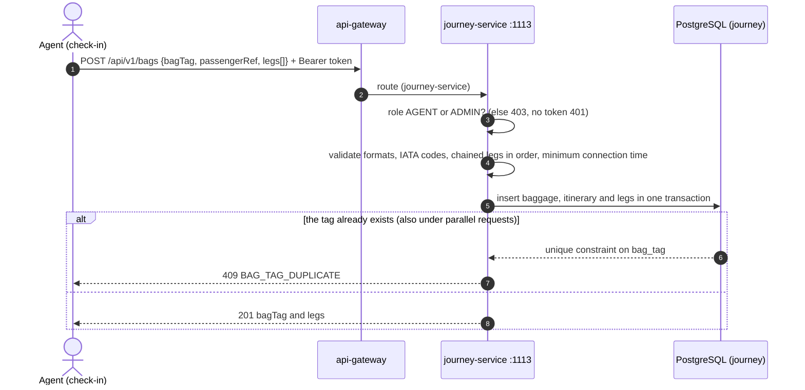
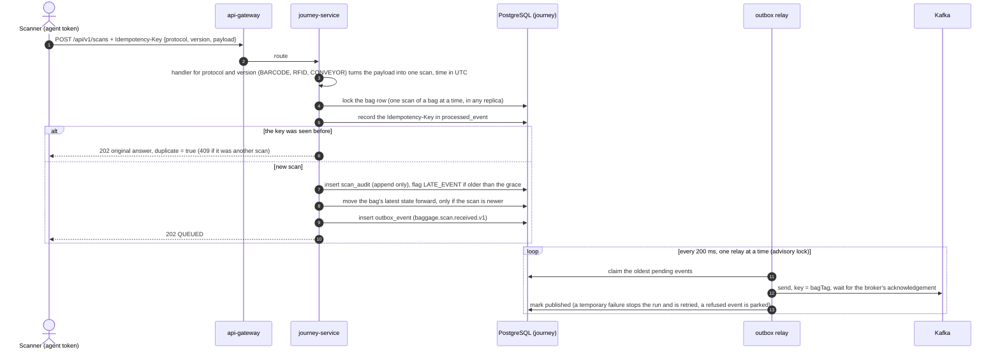
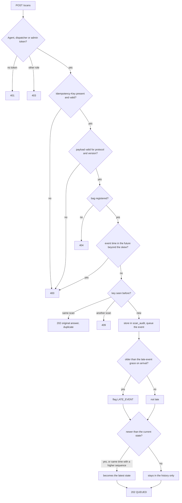
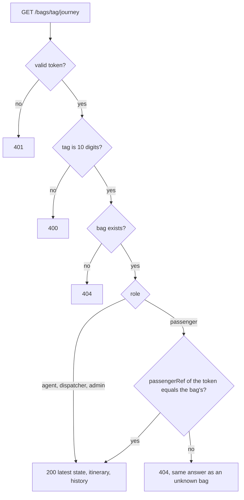

# Journey Service API

[← API overview](API.md) · [Identity Service API](IDENTITY-API.md) · [README](../../README.md)

Registers bags, takes in device scans, shows each bag's journey.

## Contents

| Section | What it covers |
|---|---|
| [At a glance](#at-a-glance) | Addresses, database, messages |
| [Calls](#calls) | The three requests |
| [Rules](#rules) | Registering, reading, scanning |
| [Scan formats](#scan-formats) | Payload fields per protocol |
| [Errors](#errors) | Status and code per case |
| [How events are published](#how-events-are-published) | Outbox and Kafka relay |
| [Known limitations](#known-limitations) | What is not done yet |
| [Flows](#flows) | Sequence and decision diagrams |
| [Every request](#every-request-in-the-postman-collection) | Postman requests, expected status |

## At a glance

| Topic | Value |
|---|---|
| Through the gateway | `http://localhost:8080/api/v1/bags` and `/api/v1/scans` |
| Directly | `http://localhost:1113` |
| Database | PostgreSQL, schema `journey` |
| Messages | Topic `baggage.scan.received.v1`, key = bag tag |
| Token | Bearer token from [Identity Service](IDENTITY-API.md) |
| Success answer | `{"success":true,"data":...,"timestamp":...}` |
| Errors | Shared shape, see [response format](../../README.md#api-response-format) |

## Calls

| Call | Roles | What it does |
|---|---|---|
| `POST /api/v1/bags` | AGENT, ADMIN | Registers a bag (201) |
| `GET /api/v1/bags/{bagTag}/journey` | all roles | Returns latest state and scan history |
| `POST /api/v1/scans` | AGENT, DISPATCHER, ADMIN | Accepts a scan (202 `QUEUED`) |

| Call | Body |
|---|---|
| `POST /api/v1/bags` | `bagTag`, `passengerRef`, `legs[]` |
| `POST /api/v1/scans` | `protocol`, `version` (optional), `payload` |
| `POST /api/v1/scans` | Header `Idempotency-Key` (required) |

## Rules

**Registering a bag**

| Topic | Rule |
|---|---|
| Bag tag | 10 digits, unique |
| Duplicate tag | `409 BAG_TAG_DUPLICATE`, also in parallel |
| Passenger reference | `P-` and 20 digits |
| Airports | 3 uppercase IATA letters |
| Each leg | Different airports, arrives after departing |
| Legs | 1 to 8, chained, in order |
| Connection time | At least `JOURNEY_MIN_CONNECTION_TIME` (`45m`) |

**Reading a journey**

| Topic | Rule |
|---|---|
| Content | Latest state, itinerary, scan history |
| History order | By event time |
| Staff | See every bag |
| Passengers | Only bags of their own `passengerRef` |
| Other bags | `404`, like an unknown bag |
| Size | Newest 500 scans (`historyTruncated`) |

**Scans**

| Topic | Rule |
|---|---|
| Idempotency-Key | Required, 1 to 128 visible characters |
| Same key again | Original answer, `duplicate: true` |
| Same key, other scan | `409 VERSION_CONFLICT` |
| Time | Stored in UTC, device zone kept |
| Future scan | More than `JOURNEY_MAX_CLOCK_SKEW` ahead: 400 |
| Late scan | Older than `JOURNEY_LATE_EVENT_GRACE` on arrival: `lateEvent` |
| Late scan | Kept and published, never the newest state |
| Latest state | Newest event time wins |
| Same time | Higher device sequence wins |
| Unknown bag | `404` |
| Payload | At most 20 fields |

Defaults: `JOURNEY_MAX_CLOCK_SKEW` is `5m`, `JOURNEY_LATE_EVENT_GRACE` is `10m`.

## Scan formats

`protocol` is `BARCODE`, `RFID` or `CONVEYOR`. `version` defaults to 1. Other versions are refused (400).

| Protocol | Payload fields |
|---|---|
| `BARCODE` | `bagTag`, `airport`, `checkpoint`, `sequence`, `scannedAt` |
| `RFID` | `tagId`, `airport`, `checkpoint`, `readCount`, `readAt`, `timezone` |
| `CONVEYOR` | `bagTag`, `airport`, `checkpoint`, `seq`, `timestamp`, `timezone` |

| Field | Format |
|---|---|
| `tagId` | The bag tag |
| `scannedAt` | ISO-8601 with offset, `2026-11-14T08:15:00+02:00` |
| `readAt` | Epoch milliseconds |
| `timestamp` | Local time, no offset, `2026-11-14T08:15:00` |
| `timezone` | IANA zone, `Europe/Istanbul` |
| `sequence`, `readCount`, `seq` | Number, 0 or more |
| `checkpoint` | `CHECK_IN`, `SORTING`, `TRANSFER`, `LOADED`, `ARRIVED`, `CLAIM` |

## Errors

| Status | `code` | When |
|---|---|---|
| 400 | `VALIDATION_ERROR` | Invalid field, itinerary, payload or key |
| 401 | `UNAUTHENTICATED` | No, invalid or expired token |
| 403 | `ACCESS_DENIED` | Role may not make this call |
| 404 | `NOT_FOUND` | Unknown bag, or another passenger's |
| 409 | `BAG_TAG_DUPLICATE` | Bag tag already registered |
| 409 | `VERSION_CONFLICT` | Key already used for another scan |

## How events are published

| Topic | What happens |
|---|---|
| Outbox | Event stored with the scan, same transaction |
| Relay | Sends events to Kafka, at least once |
| Key | The bag tag |
| Interval | `JOURNEY_OUTBOX_RELAY_DELAY` (`200ms`) |
| Order | One relay at a time (advisory lock) |
| Per bag | Events stay in order |
| Kafka down | Run stops, retried later |
| Refused for good | Parked, counted in `journey.outbox.parked` |

## Known limitations

| Area | Limitation |
|---|---|
| Scanners | Staff accounts only, no device identity |
| Throughput | One relay, one stream |
| History | Newest 500 scans only |
| Tokens | One static identity public key |
| Tokens | No key set, no rotation |
| Tokens | Bundled development key if none set |

## Flows

The diagrams are Mermaid. GitHub and IntelliJ render them.

### 1. Register a bag

### 2. Ingest a scan (idempotent) and publish the event

### 3. What happens to a scan

### 4. Who sees which bag

## Every request in the Postman collection

Generated from `postman/AeroTrace.postman_collection.json`.

| Column | Meaning |
|---|---|
| Step | Number before the request name |
| Call | Path via gateway, unless marked direct |
| Expect | Status the test script checks |

### 1. Sign in (dev dummy accounts)

| Step | Request | Call | Expect |
|---|---|---|---|
| 1.1 | Agent | `POST /api/v1/auth/login` | 200 |
| 1.2 | Passenger (owner of the bag) | `POST /api/v1/auth/login` | 200 |
| 1.3 | Other passenger | `POST /api/v1/auth/login` | 200 |

### 2. Register a bag

| Step | Request | Call | Expect |
|---|---|---|---|
| 2.1 | Register a bag | `POST /api/v1/bags` | 201 |
| 2.2 | Register the same tag again (refused) | `POST /api/v1/bags` | 409 |
| 2.3 | Invalid tag (refused) | `POST /api/v1/bags` | 400 |
| 2.4 | Connection shorter than the minimum (refused) | `POST /api/v1/bags` | 400 |
| 2.5 | As a passenger (refused) | `POST /api/v1/bags` | 403 |
| 2.6 | Without a token (refused) | `POST /api/v1/bags` | 401 |

### 3. Scans

| Step | Request | Call | Expect |
|---|---|---|---|
| 3.1 | Barcode scan (CHECK_IN) | `POST /api/v1/scans` | 202 |
| 3.2 | Same Idempotency-Key again (original answer) | `POST /api/v1/scans` | 202 |
| 3.3 | Same Idempotency-Key for another scan (refused) | `POST /api/v1/scans` | 409 |
| 3.4 | RFID scan (SORTING) | `POST /api/v1/scans` | 202 |
| 3.5 | Conveyor scan (LOADED) | `POST /api/v1/scans` | 202 |
| 3.6 | A late scan (flagged LATE_EVENT, state unchanged) | `POST /api/v1/scans` | 202 |
| 3.7 | Without an Idempotency-Key (refused) | `POST /api/v1/scans` | 400 |
| 3.8 | A bag that is not registered (refused) | `POST /api/v1/scans` | 404 |
| 3.9 | As a passenger (refused) | `POST /api/v1/scans` | 403 |
| 3.10 | Without a token (refused) | `POST /api/v1/scans` | 401 |

### 4. Journey

| Step | Request | Call | Expect |
|---|---|---|---|
| 4.1 | As the agent | `GET /api/v1/bags/{journeyBagTag}/journey` | 200 |
| 4.2 | As the passenger who owns the bag | `GET /api/v1/bags/{journeyBagTag}/journey` | 200 |
| 4.3 | As another passenger (404, like an unknown bag) | `GET /api/v1/bags/{journeyBagTag}/journey` | 404 |
| 4.4 | Without a token (refused) | `GET /api/v1/bags/{journeyBagTag}/journey` | 401 |
| 4.5 | A malformed bag tag (refused) | `GET /api/v1/bags/12345/journey` | 400 |

### 5. Journey service direct (port 1113)

| Step | Request | Call | Expect |
|---|---|---|---|
| 5.1 | Health | `GET /actuator/health` (direct :1113) | 200 |
| 5.2 | OpenAPI definition | `GET /v3/api-docs` (direct :1113) | 200 |
