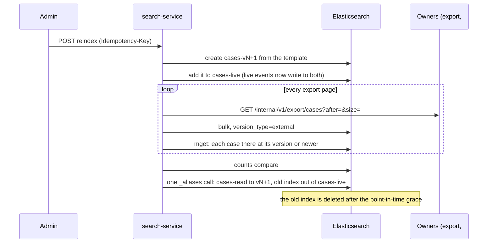

# Search Service API

[← API overview](API.md) · [ADR 0004](../adr/0004-search-read-models-and-rebuild.md) · [README](../../README.md)

Finds bags and cases and builds the hourly airport report from Elasticsearch read models. The indexes are derived data: they are fed by events, can be dropped and rebuilt from the services that own the data, and the search-service never writes to those services.

## Contents

| Section | What it covers |
|---|---|
| [At a glance](#at-a-glance) | Addresses, store, roles |
| [Calls](#calls) | The requests and who may make them |
| [Bag search](#bag-search) | Filters, order, paging, the cursor |
| [Airport report](#airport-report) | Buckets and definitions |
| [Index status and lag](#index-status-and-lag) | Lag, watermark, metrics |
| [Rebuild](#rebuild) | Jobs, the alias swap, the source |
| [Indexer](#indexer) | Topics, idempotency, dead letters |
| [Errors](#errors) | Status and code per case |
| [Every request in the Postman collection](#every-request-in-the-postman-collection) | The Search folder |
| [Known limitations](#known-limitations) | What is not done yet |

## At a glance

| Topic | Value |
|---|---|
| Through the gateway | `http://localhost:8080/api/v1/search/**`, `/api/v1/reports/**`, `/api/v1/admin/search/**` |
| Directly | `http://localhost:1117` |
| Store | Elasticsearch 9.2.8 (pinned, the Java client's version), security on; no database |
| Token | Bearer token from [Identity Service](IDENTITY-API.md) |
| Roles | Staff only. `PASSENGER` is refused (`403`) on every endpoint: no passenger data is indexed |
| Success answer | `{"success":true,"data":...,"timestamp":...}` |
| Errors | Shared shape, see [response format](../../README.md#api-response-format) |
| OpenAPI | `/v3/api-docs`, listed in the gateway's Swagger UI |
| Consistency | Eventual: reports carry `indexedThrough` and `lagSeconds` |

## Calls

| Call | Who | What it does |
|---|---|---|
| `GET /api/v1/search/bags` | AGENT, DISPATCHER, ADMIN | Searches bags, one page at a time |
| `GET /api/v1/reports/airport/{iata}?from=&to=` | AGENT, DISPATCHER, ADMIN | Hourly report of one airport |
| `GET /api/v1/search/index/status` | DISPATCHER, ADMIN | Indexing lag and indexes |
| `POST /api/v1/admin/search/reindex?scope=` | ADMIN | Starts a rebuild (`202`) |
| `GET /api/v1/admin/search/reindex/{jobId}` | ADMIN | Reads a rebuild job |

The service checks the roles itself; the gateway only checks that a token is there. Anything not listed is refused.

## Bag search

`GET /api/v1/search/bags?bagTag=&airport=&airline=&flight=&riskLevel=&caseState=&size=&cursor=`

| Parameter | Rule | Matches |
|---|---|---|
| `bagTag` | 10 digits | the bag |
| `airport` | 3 capital letters | the latest scan's airport, or the origin or destination of one of the bag's legs |
| `airline` | 2 characters, `[A-Z0-9]` | a leg's airline (from the journey-service, #28) |
| `flight` | e.g. `TK1981` | a leg's flight number |
| `riskLevel` | `LOW`, `MEDIUM`, `HIGH` | a leg's current risk |
| `caseState` | a recovery state | the state of a leg's current case |
| `size` | 1 to 100, default 20 | page size |
| `cursor` | from `nextCursor` | the next page |

All filters are optional and combine with AND; each leg filter matches when one of the bag's legs matches it. The order is `updatedAt` descending, then the stored `docId` (the bag tag), so it is total and stable.

Answer:

```json
{
  "items": [
    {
      "bagTag": "0123456789",
      "updatedAt": "2026-06-01T09:04:00Z",
      "latestScan": {"airport": "IST", "checkpoint": "LOADED", "occurredAt": "2026-06-01T09:04:00Z"},
      "legs": [
        {"legId": "LEG-1", "flightNumber": "TK1981", "airline": "TK", "origin": "IST",
         "destination": "LHR", "departureAt": "2026-06-01T10:00:00Z", "riskLevel": "HIGH",
         "caseId": "5d1c9a42-...", "caseState": "OPEN"}
      ]
    }
  ],
  "size": 20,
  "nextCursor": "eyJwaXQiOi...Q.vVb7...",
  "hasMore": true
}
```

Paging: the first request opens a point-in-time on `journeys-read` (kept for 2 minutes and renewed with each page); every page of one search sees the same snapshot, so there are no duplicates and no gaps, even while events arrive or a rebuild swaps the index. `nextCursor` is opaque and signed (HMAC-SHA256 with `SEARCH_CURSOR_SECRET`); pass it back with the same filters. No raw Elasticsearch hit or score is ever returned.

| Cursor | Answer |
|---|---|
| Changed, not a cursor, or used with other filters | `400 VALIDATION_ERROR` |
| Older than the keep-alive, or its point-in-time is gone | `410 CURSOR_EXPIRED`: start the search again |

## Airport report

`GET /api/v1/reports/airport/IST?from=2026-01-01T00:00:00Z&to=2026-01-02T00:00:00Z`

| Rule | Value |
|---|---|
| `iata` | 3 capital letters |
| `from`, `to` | ISO-8601 instants on whole UTC hours, `from <= to` |
| Range | half-open `[from, to)`, at most 31 days |
| Buckets | one per UTC hour, empty hours as zeros |
| Airport without data | `200` with zeros, never `404` |

Definitions (ADR 0004, decision 7). The airport of a case or a risk event is the origin of its leg.

| Field | Definition |
|---|---|
| `riskyBags` | distinct bags whose leg had `RiskLevel.HIGH` in the hour of the risk event |
| `resolvedRecoveries` | cases whose state is `RESOLVED`, in the hour of `resolvedAt`; `CANCELLED` and `CLOSED_AS_UNRECOVERABLE` are not counted |
| `meanResolutionSeconds` | mean of `resolvedAt - openedAt` over the cases resolved in the hour; `null` when none |
| `retries` | cases opened (hour of `openedAt`) for a bag and leg that already had an earlier case (opened before) that ended `CANCELLED` or `CLOSED_AS_UNRECOVERABLE` |
| `totals` | distinct risky bags over the range, summed counts, the mean weighted by the number of resolved cases |

Counts come from documents with deterministic ids (exact date histograms and per-document counting), never from approximate aggregations. The answer also has `indexedThrough` (everything published before it is counted) and `lagSeconds`.

## Index status and lag

`GET /api/v1/search/index/status` measures the lag now:

```json
{
  "lagEvents": 0,
  "lagSeconds": 0.0,
  "indexedThrough": "2026-06-01T09:05:12Z",
  "checkedAt": "2026-06-01T09:05:12Z",
  "indexes": {
    "cases": {"read": "cases-v1", "live": ["cases-v1"], "documents": 1520},
    "journeys": {"read": "journeys-v1", "live": ["journeys-v1"], "documents": 980}
  }
}
```

| Metric | Meaning |
|---|---|
| `search.index.lag` | seconds: 0 when the group is caught up, otherwise the age (`now - publishedAt`) of the newest indexed event |
| `search.index.lag.events` | events of the consumed topics not yet indexed and committed |
| `search.index.events{outcome,topic}` | `indexed`, `stale`, `duplicate`, `failed` (dead-lettered) |
| `search.index.delay` | time from `publishedAt` to the acknowledgement by Elasticsearch |
| `search.reindex.runs{result}` | rebuild jobs, `succeeded` or `failed` |

The metrics go to the OpenTelemetry collector like every service's; the Grafana panel comes with #19.

## Rebuild

`POST /api/v1/admin/search/reindex?scope=ALL` with header `Idempotency-Key: <1-128 printable characters>`.

| Scope | Rebuilds |
|---|---|
| `ALL` (default) | cases and journeys |
| `CASES` | the cases index |
| `JOURNEYS` | the journeys index |

Answer: `202` with the job and `Location: /api/v1/admin/search/reindex/{jobId}`. The same key returns the same job (also after it finished). While a rebuild runs, another one is `409 REINDEX_IN_PROGRESS`. The job:

```json
{
  "jobId": "1f6c...", "status": "SUCCEEDED", "scope": "CASES", "requestedBy": "<admin user id>",
  "startedAt": "...", "finishedAt": "...", "error": null,
  "results": {"cases": {"index": "cases-v1763...", "previousIndex": "cases-v1",
    "sourceCount": 1520, "indexedCount": 1520, "missing": 0, "newerThanSource": 0,
    "sourceChecksum": "8c1f...", "indexChecksum": "8c1f..."}}
}
```

How it works, without downtime (ADR 0004, decision 6):



| Rule | Value |
|---|---|
| Source | the export endpoints of the owners, with `X-Service-Token` (`SEARCH_EXPORT_SERVICE_TOKEN`), never through the gateway; for journeys also a replay of `baggage.risk.changed.v1` from offset 0 |
| Source untouched | only `GET`s and a group-less, commit-less topic read |
| Overlap | live events and the snapshot may write in any order: external versions and guarded scripts give the same result |
| Checks | every exported case in the new index at its version or newer; documents not fewer than the source |
| Failure | the new index is discarded; `-read` never moved |
| One at a time | a lock document with a lease the job renews; an expired lease (dead instance) can be taken over |

The export answer the search-service expects from #28 and #29 (`ApiResponse` envelope):

```json
{"success": true, "data": {"items": [ ... ], "nextAfter": "<last key or null>"}, "timestamp": "..."}
```

Cases carry `caseId, bagTag, legId, state, version, reason, openedAt, resolvedAt, trigger`; bags carry `bagTag`, `legs[] {legId, flightNumber, airline, origin, destination, departureAt}` and `latestScan {airport, checkpoint, legId, occurredAt, deviceSequence}`. Unknown fields are ignored.

## Indexer

| Topic | Index | Write |
|---|---|---|
| `recovery.case.changed.v1` | `cases` (`_id = caseId`), and the leg's case on `journeys` | `version_type=external` with the payload `version`; a `409` is a duplicate or a stale event, never an error |
| `baggage.scan.received.v1` | `journeys` (`_id = bagTag`) | scripted upsert: the latest scan only by a newer `(occurredAt, deviceSequence)` |
| `baggage.risk.changed.v1` | `journeys`, and the risk hours | scripted upsert: a leg's risk only by a newer `occurredAt` |
| `baggage.bag.registered.v1` | the leg lookup, `journeys` | itinerary per leg; completes cases and risk hours indexed before their leg was known |

| Rule | Value |
|---|---|
| Mapping | strict index templates for `cases-v*` and `journeys-v*`; free-text `reason` is `text` only; no passenger data |
| Offsets | committed only after the bulk is acknowledged; every item is checked |
| Transient failures | `429`, `5xx`, timeouts: retried with a doubling wait, the batch is retried until Elasticsearch is back; nothing is committed meanwhile |
| Poison events | to `baggage.dead-letter.v1`, like the recovery-service's consumers |
| Correlation | the envelope's `correlationId` is put into the logging context; none is generated |
| Revision 2 of case events (#29) | `openedAt`, `resolvedAt`, `trigger` are read when present, `null` otherwise |

## Errors

| Case | Status | Code |
|---|---|---|
| No token, or invalid or expired | 401 | `UNAUTHENTICATED` |
| Wrong role, or a passenger | 403 | `ACCESS_DENIED` |
| A parameter breaks its rule (size, IATA, dates, range, enum), no `Idempotency-Key` | 400 | `VALIDATION_ERROR` |
| A changed cursor, or one used with other filters | 400 | `VALIDATION_ERROR` |
| An expired cursor | 410 | `CURSOR_EXPIRED` |
| Unknown rebuild job | 404 | `NOT_FOUND` |
| A rebuild is already running | 409 | `REINDEX_IN_PROGRESS` |
| Elasticsearch cannot be reached or does not answer | 503 | `SEARCH_UNAVAILABLE` |

## Every request in the Postman collection

Folder **Search Service**, run top to bottom with the dev dummy accounts.

| Folder | Request | Expect |
|---|---|---|
| 1 Sign in | Admin, dispatcher, agent, passenger | `200`, tokens stored |
| 2 Search bags (agent) | First page `size=2`; next page with the cursor; combined filters; `size=101`; a forged cursor | `200`, `200`, `200`, `400`, `400` |
| 3 Airport report (dispatcher) | IST over two hours; `from` after `to` | `200` with two buckets, `400` |
| 4 Index status (dispatcher) | Status; as the agent | `200`, `403` |
| 5 Rebuild (admin) | Start `scope=CASES`; the same key again; read the job; as the dispatcher | `202`, `202` same job, `200`, `403` |
| 6 Refused calls | Passenger search; passenger report; no token | `403`, `403`, `401` |

Variables: `searchAdminUsername`, `searchDispatcherUsername`, `searchAgentUsername`, `searchPassengerUsername`, `searchPassword` (the dev accounts); the scripts fill the four tokens, `searchCursor`, `searchReindexKey` and `searchJobId`.

## Known limitations

| Area | Limitation |
|---|---|
| Rebuild source | The export endpoints are #28 (journey) and #29 (recovery) and do not exist yet: a rebuild against the real stack ends `FAILED` (404) and changes nothing. AT-18 is proven against an in-memory stand-in only |
| Itinerary data | `airline`, `origin`, `destination` (and so the `airport` of cases and the report) need `baggage.bag.registered.v1` (#28); until then only the scan airport and flight are known |
| Case times | `openedAt`, `resolvedAt` and `trigger` come with case events revision 2 (#29); revision 1 cases have no resolution time and are not in the report's resolved counts |
| Risk history | replayed from `baggage.risk.changed.v1`; history older than its retention cannot be rebuilt (it becomes compacted with #15) |
| Watermark | `indexedThrough` and `lagSeconds` use the newest event this instance indexed; with several instances each reports its own partitions |
| Cursor secret | without `SEARCH_CURSOR_SECRET` each instance signs with a random key, so a cursor only works on the instance that issued it |
| Grafana | the lag panel comes with #19 |
