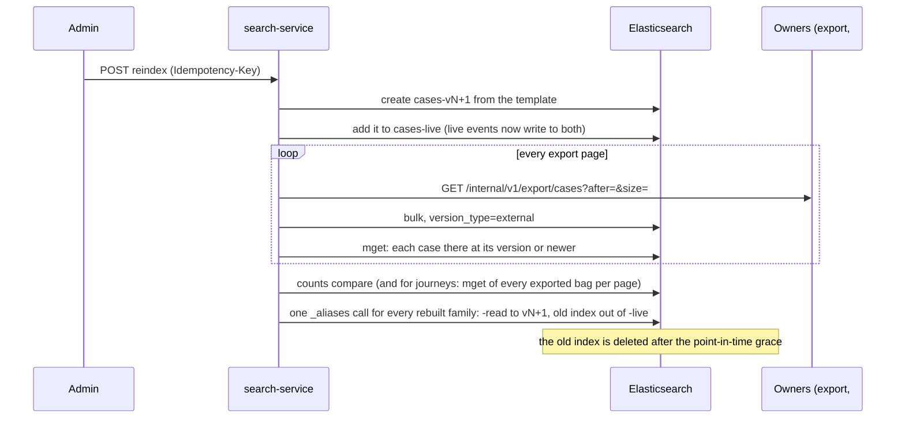

# Search Service API

[← API overview](API.md) · [ADR 0004](../adr/0004-search-read-models-and-rebuild.md) · [README](../../README.md)

Finds bags and cases and builds the hourly airport report from Elasticsearch read models. The indexes are derived data: they are fed by events, can be dropped and rebuilt from the services that own the data, and the search-service never writes to those services.

## Contents

| Section | What it covers |
|---|---|
| [At a glance](#at-a-glance) | Addresses, store, roles |
| [Calls](#calls) | The requests and who may make them |
| [Bag search](#bag-search) | Filters, order, paging, the cursor |
| [Airport report](#airport-report) | Buckets and definitions |
| [Index status and lag](#index-status-and-lag) | Lag, watermark, metrics |
| [Rebuild](#rebuild) | Jobs, the alias swap, the source |
| [Indexer](#indexer) | Topics, idempotency, dead letters |
| [Errors](#errors) | Status and code per case |
| [Configuration and security](#configuration-and-security) | Required settings, the Elasticsearch user, the image tag |
| [Every request in the Postman collection](#every-request-in-the-postman-collection) | The Search folder |
| [Known limitations](#known-limitations) | What is not done yet |

## At a glance

| Topic | Value |
|---|---|
| Through the gateway | `http://localhost:8080/api/v1/search/**`, `/api/v1/reports/**`, `/api/v1/admin/search/**` |
| Directly | `http://localhost:1117` (Compose publishes it on loopback only) |
| Store | Elasticsearch 9.x, security on; no database. Java client and test image 9.2.8; the Compose files use the `latest` tag, which Elastic does not publish (see [the image tag](#the-elasticsearch-image-tag)) |
| Token | Bearer token from [Identity Service](IDENTITY-API.md) |
| Roles | Staff only. `PASSENGER` is refused (`403`) on every endpoint: no passenger data is indexed |
| Success answer | `{"success":true,"data":...,"timestamp":...}` |
| Errors | Shared shape, see [response format](../../README.md#api-response-format) |
| OpenAPI | `/v3/api-docs`, listed in the gateway's Swagger UI |
| Consistency | Eventual: reports carry `indexedThrough` and `lagSeconds` |

## Calls

| Call | Who | What it does |
|---|---|---|
| `GET /api/v1/search/bags` | AGENT, DISPATCHER, ADMIN | Searches bags, one page at a time |
| `GET /api/v1/reports/airport/{iata}?from=&to=` | AGENT, DISPATCHER, ADMIN | Hourly report of one airport |
| `GET /api/v1/search/index/status` | DISPATCHER, ADMIN | Indexing lag and indexes |
| `POST /api/v1/admin/search/reindex?scope=` | ADMIN | Starts a rebuild (`202`) |
| `GET /api/v1/admin/search/reindex/{jobId}` | ADMIN | Reads a rebuild job |

The service checks the roles itself; the gateway only checks that a token is there. Anything not listed is refused.

## Bag search

`GET /api/v1/search/bags?bagTag=&airport=&airline=&flight=&riskLevel=&caseState=&size=&cursor=`

| Parameter | Rule | Matches |
|---|---|---|
| `bagTag` | 10 digits | the bag |
| `airport` | 3 capital letters | the latest scan's airport, or the origin or destination of one of the bag's legs |
| `airline` | 2 characters, `[A-Z0-9]` | a leg's airline (from the journey-service, #28) |
| `flight` | e.g. `TK1981` | a leg's flight number |
| `riskLevel` | `LOW`, `MEDIUM`, `HIGH` | a leg's current risk |
| `caseState` | a recovery state | the state of a leg's current case |
| `size` | 1 to 100, default 20 | page size |
| `cursor` | from `nextCursor` | the next page |

All filters are optional and combine with AND; each leg filter matches when one of the bag's legs matches it. The order is `updatedAt` descending, then the stored `docId` (the bag tag), so it is total and stable.

Answer:

```json
{
  "items": [
    {
      "bagTag": "0123456789",
      "updatedAt": "2026-06-01T09:04:00Z",
      "latestScan": {"airport": "IST", "checkpoint": "LOADED", "occurredAt": "2026-06-01T09:04:00Z"},
      "legs": [
        {"legId": "LEG-1", "flightNumber": "TK1981", "airline": "TK", "origin": "IST",
         "destination": "LHR", "departureAt": "2026-06-01T10:00:00Z", "riskLevel": "HIGH",
         "caseId": "5d1c9a42-...", "caseState": "OPEN"}
      ]
    }
  ],
  "size": 20,
  "nextCursor": "eyJwaXQiOi...Q.vVb7...",
  "hasMore": true
}
```

Paging: the first page is a plain search of `journeys-read`. Only when it has a next page is a point-in-time opened (kept for 1 minute, `SEARCH_PIT_KEEP_ALIVE`, and renewed with each page), so a search that fits one page holds no search context, and open points-in-time (a limited cluster resource) are only held by searches that really page. The pages after the first see one snapshot, so they have no duplicates and no gaps, even while events arrive or a rebuild swaps the index; the snapshot is taken just after the first page, so a bag that changed in that instant can cross the first page's boundary. `nextCursor` is opaque and signed (HMAC-SHA256 with `SEARCH_CURSOR_SECRET`, checked before the cursor is parsed); pass it back with the same filters. No raw Elasticsearch hit or score is ever returned.

| Cursor | Answer |
|---|---|
| Changed, not a cursor, or used with other filters | `400 VALIDATION_ERROR` |
| Older than the keep-alive, or its point-in-time is gone | `410 CURSOR_EXPIRED`: start the search again |

## Airport report

`GET /api/v1/reports/airport/IST?from=2026-01-01T00:00:00Z&to=2026-01-02T00:00:00Z`

| Rule | Value |
|---|---|
| `iata` | 3 capital letters |
| `from`, `to` | ISO-8601 instants on whole UTC hours, `from <= to`, between `2000-01-01T00:00:00Z` and `2100-01-01T00:00:00Z` (outside: `400`) |
| Range | half-open `[from, to)`, at most 31 days |
| Buckets | one per UTC hour, empty hours as zeros |
| Airport without data | `200` with zeros, never `404` |
| Size | the report reads at most `SEARCH_REPORT_MAX_SCANNED_DOCUMENTS` documents (200000): more is `422 REPORT_TOO_LARGE`, narrow the range |
| Time | at most `SEARCH_REPORT_TIMEOUT` (10s): longer is `503 SEARCH_UNAVAILABLE` |

Definitions (ADR 0004, decision 7). The airport of a case or a risk event is the origin of its leg.

| Field | Definition |
|---|---|
| `riskyBags` | distinct bags whose leg had `RiskLevel.HIGH` in the hour of the risk event |
| `resolvedRecoveries` | cases whose state is `RESOLVED`, in the hour of `resolvedAt`; `CANCELLED` and `CLOSED_AS_UNRECOVERABLE` are not counted |
| `meanResolutionSeconds` | mean of `resolvedAt - openedAt` over the cases resolved in the hour; `null` when none |
| `retries` | cases opened (hour of `openedAt`) for a bag and leg that already had an earlier case (opened before) that ended `CANCELLED` or `CLOSED_AS_UNRECOVERABLE` |
| `totals` | distinct risky bags over the range, summed counts, the mean weighted by the number of resolved cases |

Counts come from documents with deterministic ids (exact date histograms and per-document counting), never from approximate aggregations. The per-document counts are capped scans that fetch only the fields they need; nothing else is held in memory. The answer also has `indexedThrough` (everything published before it is counted) and `lagSeconds`, as the scheduler last measured them (every `SEARCH_LAG_CHECK_INTERVAL`, 15s): a report never calls Kafka itself.

## Index status and lag

`GET /api/v1/search/index/status` shows the lag as last measured (every `SEARCH_LAG_CHECK_INTERVAL`; `checkedAt` says when). A request never calls Kafka itself:

```json
{
  "lagEvents": 0,
  "lagSeconds": 0.0,
  "indexedThrough": "2026-06-01T09:05:12Z",
  "checkedAt": "2026-06-01T09:05:12Z",
  "indexes": {
    "cases": {"read": "cases-v1", "live": ["cases-v1"], "documents": 1520},
    "journeys": {"read": "journeys-v1", "live": ["journeys-v1"], "documents": 980}
  }
}
```

| Metric | Meaning |
|---|---|
| `search.index.lag` | seconds: 0 when the group is caught up, otherwise the age (`now - publishedAt`) of the newest indexed event |
| `search.index.lag.events` | events of the consumed topics not yet indexed and committed |
| `search.index.events{outcome,topic}` | `indexed`, `stale`, `duplicate`, `failed` (dead-lettered) |
| `search.index.delay` | time from `publishedAt` to the acknowledgement by Elasticsearch |
| `search.reindex.runs{result}` | rebuild jobs, `succeeded` or `failed` |

The metrics go to the OpenTelemetry collector like every service's; the lag, outcome and rebuild panels are in the "AeroTrace - Elasticsearch" Grafana dashboard.

## Rebuild

`POST /api/v1/admin/search/reindex?scope=ALL` with header `Idempotency-Key: <1-128 printable characters>`.

| Scope | Rebuilds |
|---|---|
| `ALL` (default) | cases and journeys |
| `CASES` | the cases index |
| `JOURNEYS` | the journeys index |

Answer: `202` with the job and `Location: /api/v1/admin/search/reindex/{jobId}`. The same key from the same admin with the same scope returns the same job (also after it finished). The same key with another scope, or from another admin, is `422 IDEMPOTENCY_KEY_REUSED`. A key names its job for `SEARCH_REINDEX_KEY_TTL` (24h); older keys are purged and may be used again. While a rebuild runs, another one is `409 REINDEX_IN_PROGRESS`. The job:

```json
{
  "jobId": "1f6c...", "status": "SUCCEEDED", "scope": "CASES", "requestedBy": "<admin user id>",
  "startedAt": "...", "finishedAt": "...", "error": null,
  "results": {"cases": {"index": "cases-v1763...", "previousIndex": "cases-v1",
    "sourceCount": 1520, "indexedCount": 1520, "missing": 0, "newerThanSource": 0,
    "sourceChecksum": "8c1f...", "indexChecksum": "8c1f..."}}
}
```


With scope `ALL` or `JOURNEYS`, `results.journeys` has `index`, `previousIndex`, `sourceCount`, `indexedCount`, `missing` (exported bags without a journey in the new index), `sourceChecksum`, `indexChecksum` (sums of a fingerprint of each bag tag) and `riskEventsReplayed`.

A job is stored in the `search-jobs` index with audit fields (not part of the API view): `createdAt` and `createdBy` (the admin's token subject) when it starts, `lastModifiedAt` and `lastModifiedBy` on every save (`system` for the worker that finishes it). See [ADR 0003](../adr/0003-spring-data-auditing.md).

Failure reasons a job can show (`error`, a fixed text):

| `error` | Meaning |
|---|---|
| `cases: exported records missing from the new index`, `journeys: ...` | the per-page check found an exported case or bag missing |
| `...: fewer documents than records in the source` | the counts do not match (for example a source that repeats records) |
| `...: the export did not advance`, `...: the export has more pages than the maximum` | a source whose paging does not end (`SEARCH_REINDEX_MAX_PAGES`, 100000) |
| `the rebuild took longer than its maximum duration` | `SEARCH_REINDEX_MAX_DURATION` (2h) |
| `export unauthorized` | the owner answered 401/403, or no `SEARCH_EXPORT_SERVICE_TOKEN` is set (outside the dev profiles the job fails before calling) |
| `export endpoint not found`, `export page larger than the maximum` | 404 (an owner without the export), an answer over `SEARCH_EXPORT_MAX_PAGE_BYTES` (16 MiB) |
| `rebuild lock lost: another job took it over`, `rebuild lock not renewed: ...` | the job could not keep its lock and stopped |
| `abandoned: its instance stopped renewing the rebuild lock` | set by the next job on a job whose instance died |
| `failed: <exception class>` | anything else |

How it works, without downtime (ADR 0004, decision 6):



| Rule | Value |
|---|---|
| Source | the export endpoints of the owners, with `X-Service-Token` (`SEARCH_EXPORT_SERVICE_TOKEN`), never through the gateway; for journeys also a replay of `baggage.risk.changed.v1` from offset 0 |
| Source untouched | only `GET`s and a group-less, commit-less topic read |
| Overlap | live events and the snapshot may write in any order: external versions and guarded scripts give the same result |
| Checks | per export page, a realtime `mget`: every exported case in the new index at its version or newer, every exported bag with its journey; documents not fewer than the source; id checksums recorded |
| Swap | one atomic `_aliases` call for all rebuilt families: with scope `ALL` either both `-read` aliases move or neither does |
| Failure | the new indexes are discarded; no `-read` alias moved |
| One at a time | a lock document with a lease the job renews every `SEARCH_REINDEX_HEARTBEAT`; renewals and releases are conditional on the holder, so a job never extends or deletes another job's lock. A job that cannot renew its lock, or finds it taken over, stops and fails without swapping |
| Dead instance | an expired lease can be taken over; the job that takes it marks the abandoned job `FAILED` and discards the indexes it left in the `-live` aliases |
| Rebuilt `updatedAt` | the latest of the bag's leg departures, latest scan, case `openedAt`/`resolvedAt` and replayed risk events (the export has no event times); so it is never missing for a bag with legs, and two rebuilds give the same order |
| Proof (AT-18) | end to end against the real journey- and recovery-service: `RebuildAgainstRealOwnersTest` (see [TRACEABILITY](../requirements/TRACEABILITY.md)) |
| Not rebuilt | the support indexes `search-legs` (leg lookup) and `search-risk-hours` are only written to, never cleared: legs are reloaded from the bag export, risk hours from the risk topic replay; documents of legs or risk events that no longer exist at the source stay (the report would count risk hours whose events were since removed from the topic) |

The export answer of the recovery-service (#29, `GET /internal/v1/export/cases`) and the journey-service (#28, `GET /internal/v1/export/bags`), see [RECOVERY-API](RECOVERY-API.md#internal-export) and [JOURNEY-API](JOURNEY-API.md#internal-export) (`ApiResponse` envelope):

```json
{"success": true, "data": {"items": [ ... ], "nextAfter": "<last key or null>"}, "timestamp": "..."}
```

One source of truth: both sides use the common-module types, `ExportApi` (paths, `size` 1 to 500), `ExportPage`, `CaseChangedPayload` (a case is exported exactly as its revision 2 event carries it: `caseId, bagTag, legId, state, version, reason, openedAt, resolvedAt, trigger, assignedTo`) and `BagExport` (`bagTag`, `legs[] {legId, flightNumber, airline, origin, destination, departureAt}`, `latestScan {airport, checkpoint, legId, occurredAt, deviceSequence}` or `null`). The answer is read with the tolerant event reader: unknown fields are ignored, an enum value a newer owner adds (a new `trigger`) reads as `null`. `reason` and `assignedTo` are read but never indexed.

## Indexer

| Topic | Index | Write |
|---|---|---|
| `recovery.case.changed.v1` | `cases` (`_id = caseId`), and the leg's case on `journeys` | `version_type=external` with the payload `version`; a `409` is a duplicate or a stale event, never an error |
| `baggage.scan.received.v1` | `journeys` (`_id = bagTag`) | scripted upsert: the latest scan only by a newer `(occurredAt, deviceSequence)` |
| `baggage.risk.changed.v1` | `journeys`, and the risk hours | scripted upsert: a leg's risk only by a newer `occurredAt` |
| `baggage.bag.registered.v1` | the leg lookup, `journeys` | itinerary per leg (formats checked up front); completes cases and risk hours indexed before their leg was known, found by a realtime "waiting" mark, so a registration nothing waits for costs one `mget` |

| Rule | Value |
|---|---|
| Mapping | strict index templates for `cases-v*` and `journeys-v*`; the free-text case `reason` is not indexed (it may name people or places); no passenger data |
| Offsets | committed only after the bulk is acknowledged; every item is checked |
| Transient failures | `429`, `5xx`, timeouts: retried with a doubling wait, the batch is retried until Elasticsearch is back; nothing is committed meanwhile |
| Poison events | to `baggage.dead-letter.v1`, like the recovery-service's consumers, once the batch's write succeeded (a batch retried during an outage publishes no duplicates) |
| Refused by Elasticsearch | an item refused for good (mapping, keyword length) dead-letters its event; never retried forever |
| Correlation | the envelope's `correlationId` is put into the logging context; none is generated |
| Revision 2 of case events (#29) | the recovery-service writes revision 2: `openedAt`, `resolvedAt` and `trigger` are indexed and feed the report (resolved recoveries, mean resolution time, retries). A revision 1 event (written before #29) still indexes, with them `null` |
| Registration events (#28) | `baggage.bag.registered.v1` (`Topics.BAG_REGISTERED`, payload `BagRegisteredPayload`), published by the journey-service once per bag with every leg and its airline |

## Errors

| Case | Status | Code |
|---|---|---|
| No token, or invalid or expired | 401 | `UNAUTHENTICATED` |
| Wrong role, or a passenger | 403 | `ACCESS_DENIED` |
| A parameter breaks its rule (size, IATA, dates, range, enum), no `Idempotency-Key` | 400 | `VALIDATION_ERROR` |
| A changed cursor, or one used with other filters | 400 | `VALIDATION_ERROR` |
| An expired cursor | 410 | `CURSOR_EXPIRED` |
| Unknown rebuild job | 404 | `NOT_FOUND` |
| A rebuild is already running | 409 | `REINDEX_IN_PROGRESS` |
| An Idempotency-Key reused for another scope or by another admin | 422 | `IDEMPOTENCY_KEY_REUSED` |
| A report that would read too many documents | 422 | `REPORT_TOO_LARGE` |
| Elasticsearch cannot be reached or does not answer; a report that takes too long | 503 | `SEARCH_UNAVAILABLE` |

## Configuration and security

Outside the `local`, `dev` and `test` Spring profiles the service refuses to start without these (each falls back to a development default only under those profiles):

| Setting | Rule | Development fallback |
|---|---|---|
| `IDENTITY_JWT_PUBLIC_KEY` or `IDENTITY_JWT_PUBLIC_KEY_LOCATION` | the identity-service public key (PEM) | the development key bundled in the jar, whose private half is in the repository |
| `SEARCH_CURSOR_SECRET` | at least 32 bytes, the same on every instance; a shorter one is refused under every profile | a random key per instance |
| `ELASTICSEARCH_USERNAME` | a named user, see below | `elastic` |
| `SEARCH_EXPORT_SERVICE_TOKEN` | the token the export endpoints accept (only checked when a rebuild runs: the job fails with `export unauthorized`) | none sent |

`docker-compose.yml` gives `ELASTIC_PASSWORD`, `SEARCH_CURSOR_SECRET` and `SEARCH_EXPORT_SERVICE_TOKEN` dev-only defaults (set your own wherever the data matters), passes `ELASTICSEARCH_USERNAME=elastic` and names the bundled development public key explicitly (`IDENTITY_JWT_PUBLIC_KEY_LOCATION=classpath:keys/public.pem`, the pair identity-service signs with in that stack): override both wherever the data matters. Port 1117 is published on `127.0.0.1` only; the gateway reaches the service over the Compose network, and it strips `X-Service-Token` from every search route.

### A least-privilege Elasticsearch user

Compose uses the `elastic` superuser for convenience; nowhere else should. The service needs, and only needs: its index families and their aliases (`cases-*`, `journeys-*`), its support indexes (`search-legs`, `search-risk-hours`, `search-jobs`), its two index templates, and the cluster health. Create the role and the user once (as `elastic`, from a container on the network or with 9200 reachable):

```bash
curl -u "elastic:$ELASTIC_PASSWORD" -X PUT http://localhost:9200/_security/role/aerotrace_search \
  -H 'Content-Type: application/json' -d '{
  "cluster": ["monitor", "manage_index_templates"],
  "indices": [{
    "names": ["cases-*", "journeys-*", "search-legs", "search-risk-hours", "search-jobs"],
    "privileges": ["create_index", "delete_index", "manage", "read", "write", "view_index_metadata"]
  }]
}'
curl -u "elastic:$ELASTIC_PASSWORD" -X PUT http://localhost:9200/_security/user/search-service \
  -H 'Content-Type: application/json' -d '{"password": "<a strong password>", "roles": ["aerotrace_search"]}'
```

Then run the service with `ELASTICSEARCH_USERNAME=search-service` and `ELASTIC_PASSWORD=<that password>`. `manage` on the index patterns covers the alias swaps (`_aliases` needs `manage` on both the indexes and the aliases, which match the same patterns: `cases-read`, `cases-live`, `journeys-read`, `journeys-live`), the point-in-time and refresh calls; `monitor` and `manage_index_templates` cover the cluster health and the templates. This is documented, not automated: a Compose init step would need a second password in `.env` for every developer.

### The Elasticsearch image tag

At the user's request both Compose files use `docker.elastic.co/elasticsearch/elasticsearch:latest`. **Elastic publishes no `latest` tag** for this image (nor `9`), so pulling it currently fails with `manifest unknown`. The one-line fix is a concrete tag in the two `image:` lines, for example `docker.elastic.co/elasticsearch/elasticsearch:9.5.3` (the newest 9.x verified to exist). The Java client and the Testcontainers image are 9.2.8; a 9.2 client against a newer 9.x server is supported by Elastic.

## Every request in the Postman collection

Folder **Search Service**, run top to bottom with the dev dummy accounts.

| Folder | Request | Expect |
|---|---|---|
| 1 Sign in | Admin, dispatcher, agent, passenger | `200`, tokens stored |
| 2 Search bags (agent) | First page `size=2`; next page with the cursor; combined filters; `size=101`; a forged cursor | `200`, `200`, `200`, `400`, `400` |
| 3 Airport report (dispatcher) | IST over two hours; `from` after `to` | `200` with two buckets, `400` |
| 4 Index status (dispatcher) | Status; as the agent | `200`, `403` |
| 5 Rebuild (admin) | Start `scope=CASES`; the same key again; read the job; as the dispatcher | `202`, `202` same job, `200`, `403` |
| 6 Refused calls | Passenger search; passenger report; no token | `403`, `403`, `401` |

Variables: `searchAdminUsername`, `searchDispatcherUsername`, `searchAgentUsername`, `searchPassengerUsername`, `searchPassword` (the dev accounts); the scripts fill the four tokens, `searchCursor`, `searchReindexKey` and `searchJobId`.

## Known limitations

| Area | Limitation |
|---|---|
| Rebuild source | The export endpoints of the journey-service (#28) and the recovery-service (#29), with the shared secret `SEARCH_EXPORT_SERVICE_TOKEN` on both sides (the owners refuse every call without one outside the `local` and `dev` profiles). `docker-compose.yml` passes the same dev-only default to all three services |
| Itinerary data | `airline`, `origin`, `destination` (and so the `airport` of cases and the report) come from `baggage.bag.registered.v1` and the bag export (#28). A case gets them only when its `legId` is a journey leg id; the recovery-service accepts leg ids of at most 32 characters, the journey-service's are 36-character UUIDs, so today cases opened from journey legs are refused there (open, see [RECOVERY-API](RECOVERY-API.md#known-limitations)) |
| Case times | `openedAt`, `resolvedAt` and `trigger` come from case events revision 2 and the case export (#29). A case indexed from a revision 1 event has none until its next event or a rebuild, and is not in the report's resolved counts or mean until then. `resolvedAt` exists only for `RESOLVED` cases |
| Risk history | replayed from `baggage.risk.changed.v1`; history older than its retention cannot be rebuilt (it becomes compacted with #15) |
| Watermark | `indexedThrough` and `lagSeconds` use the newest event this instance indexed; with several instances each reports its own partitions |
| Cursor secret | required outside the dev profiles; under `local`, `dev` or `test` without it each instance signs with a random key, so a cursor only works on the instance that issued it |
| Elasticsearch user | Compose uses the `elastic` superuser; the least-privilege user below is documented, not created by Compose |
| Paging snapshot | the point-in-time is opened after the first page, so a bag that changed in that instant can cross the first page's boundary |
| Grafana | the "AeroTrace - Elasticsearch" dashboard (`observability/grafana/dashboards/elasticsearch.json`) shows the lag and the indexing outcomes |
